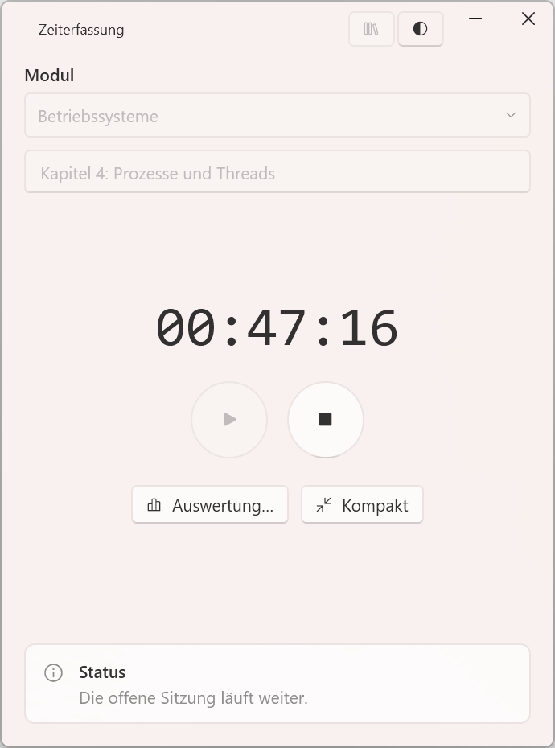
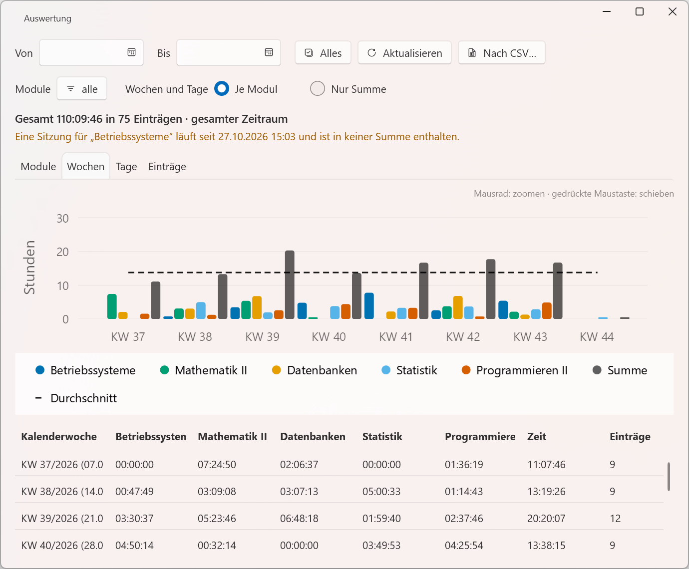

# MagieSoft TimeTracking

*[Deutsche Fassung](README.de.md)*

A small Windows program that records how much time goes into each module. Pick a module, optionally type what you are working on, press **Play** — and **Stop**
when you are done. That is the whole idea; it is deliberately kept simple.

<p align="center">
  <picture>
    <source media="(prefers-color-scheme: dark)" srcset="docs/screenshots/hauptfenster-dark.png">
    
  </picture>
</p>

The user interface is in German. Inside the code, the projects and the executable carry the
German name *Zeiterfassung* ("time tracking").

## What it does

- **Play and Stop.** One running session at a time, per module, with an optional free-text note.
- **Survives crashes.** The session is written to disk the moment you press Play. If the program
  or the computer goes down before Stop, the next start offers to close the entry or let it keep
  running. Every file is written to a temporary side file first and then renamed in one step, so a
  crash in the middle of writing never leaves half a file behind.
- **Moves between two computers** — without a sync mechanism of its own. The data files live in a
  folder you choose, typically inside OneDrive, and OneDrive carries them over. The path to that
  folder is kept per computer in `AppData\Local` and does not travel.
- **Files you can repair by hand.** Plain, indented JSON with the module name spelled out in every
  entry and times in ISO 8601 local time with offset. The format is described field by field in
  [`docs/DATENFORMAT.md`](docs/DATENFORMAT.md) (German; English in
  [`docs/en/DATENFORMAT.md`](docs/en/DATENFORMAT.md)).
- **Reports.** Totals per module, week and day, broken down by module with an average line, a
  module filter and CSV export for Excel.
- **Light or dark**, or following Windows, and a compact always-on-top mode.

What it deliberately does **not** do: it does not sync anything itself, it sends nothing anywhere,
and it has no screen for editing recorded times — corrections are made in the file.

<p align="center">
  <picture>
    <source media="(prefers-color-scheme: dark)" srcset="docs/screenshots/auswertung-wochen-dark.png">
    
  </picture>
</p>

## Download

A ready-built version without debugging files is available as a ZIP on the
[Releases](../../releases) page. Unpack it anywhere and start `Zeiterfassung.App.exe`; the whole
folder belongs together.

## Requirements

- Windows 10 version 2004 or later, or Windows 11, on **x64**
- To run it: the **.NET 10 Desktop Runtime**
- To build it: the **.NET 10 SDK** (Visual Studio 2026 is optional)

## Build, test, run

From the repository root:

```bash
dotnet build
dotnet test
dotnet run --project src/Zeiterfassung.App
```

On first start the program asks for a folder for its data; any empty folder will do for trying it
out. Details in
[`docs/en/ENTWICKLUNG.md`](docs/en/ENTWICKLUNG.md).

## How it is built

Three projects: a logic core without any UI and without third-party packages, a WPF shell wired up
by code-behind, and a test project that covers the core only. The shell uses
[LiveCharts2](https://github.com/beto-rodriguez/LiveCharts2) for the charts and
[WPF-UI](https://github.com/lepoco/wpfui) for the look and the light/dark switch.

## Documentation

The documentation in [`docs/`](docs/) is written in German and is authoritative. Four documents are
also available in English under [`docs/en/`](docs/en/); each carries a note saying which state of
the German original it reflects.

| Question | Document |
|---|---|
| Where do I start? Building, testing, which class does what | [`ENTWICKLUNG.md`](docs/en/ENTWICKLUNG.md) |
| How is it cut, and why? | [`ARCHITECTURE.md`](docs/en/ARCHITECTURE.md) |
| What do the files look like, field by field? | [`DATENFORMAT.md`](docs/en/DATENFORMAT.md) |
| Classes and flows as diagrams | [`DIAGRAMME.md`](docs/en/DIAGRAMME.md) |

The source code — identifiers and comments — is in English.

## License

[MIT](LICENSE) © 2026 Markus, MagieSoft. The licences of the bundled third-party libraries are
in [THIRD-PARTY-NOTICES.txt](THIRD-PARTY-NOTICES.txt).
