# Diagramme — MagieSoft TimeTracking

> Dieses Dokument legt Klassen und Abläufe der App vollständig offen. Es wendet sich an einen
> **Dritten**, der den Code nicht kennt und ihn auch nicht lesen will. Was hier steht, soll ohne
> einen Blick in den Quelltext verständlich sein.
>
> Die Diagramme sind in **Mermaid** geschrieben. GitHub stellt sie unmittelbar dar; in einem
> Editor ohne Mermaid-Unterstützung bleiben sie lesbarer Text. Jedes Diagramm hat davor oder
> danach einen Absatz in Prosa — wer die Notation nicht mag, kommt auch ohne sie durch.
>
> Das große Bild steht in `ARCHITECTURE.md`, die Felder der Dateien in `DATENFORMAT.md`, das
> Verhalten der Oberfläche in `OBERFLAECHE.md`. Dieses Dokument wiederholt davon nur so viel, wie
> zum Verständnis der Diagramme nötig ist.

## Inhalt

**Teil A — die Klassen.** Ein Übersichtsdiagramm mit allen 38 Typen, danach vier Diagramme, die
je einen Bereich mit allen seinen Mitgliedern zeigen.

**Teil B — die Abläufe.** Sechs Diagramme, eines je Ablauf.

---

# Teil A — Die Klassen

Die App besteht aus **38 Typen**: 26 im Logik-Kern und 12 in der WPF-Schale. Der Kern zerfällt in
vier Namensräume — Modell, Speicher, Ablauf und Auswertung —, die Schale ist flach.

Die Aufteilung folgt einer Regel: **Der Kern kennt die Schale nicht.** Jeder Pfeil zwischen den
beiden Projekten zeigt von der Schale zum Kern, keiner zurück. Dasselbe gilt innerhalb des Kerns
nach unten: Das Modell weiß nichts vom Speicher, der Speicher nichts vom Ablauf.

## A1. Übersicht über alle Typen

Dieses Diagramm nennt nur die Namen und die Beziehungen. Die Mitglieder stehen in den vier
Diagrammen danach.

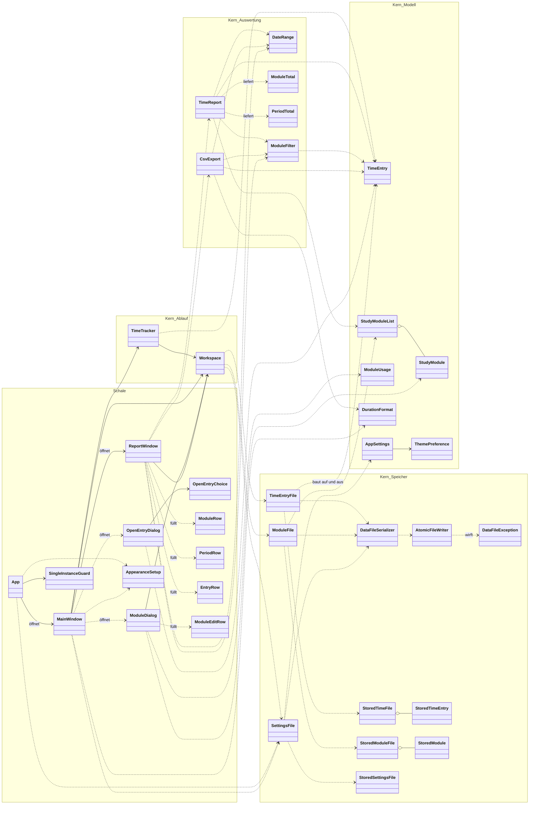

Drei Dinge lassen sich daraus ablesen:

**Die Schale hängt am Kern, nie umgekehrt.** Alle Pfeile zwischen den beiden Blöcken gehen nach
links. Deshalb ist der Kern ohne Fenster prüfbar, und deshalb sagt `ARCHITECTURE.md`, dass er
weder Schale noch Tests kennt.

**Der Speicher hat eine Doppelschicht.** Zu jedem Modelltyp gibt es einen `Stored…`-Zwilling. Die
Modelltypen prüfen sich selbst und lassen sich nicht widersprüchlich erzeugen; die `Stored…`-Typen
haben nur nullbare Felder und bilden ab, was tatsächlich in der Datei steht — auch wenn dort
etwas fehlt. Der Übergang zwischen beiden ist genau die Stelle, an der eine von Hand beschädigte
Datei auffällt.

**Jedes Fenster hat seine eigenen Zeilen-Typen.** `ModuleRow`, `PeriodRow`, `EntryRow` und
`ModuleEditRow` sind reine Anzeigezeilen: fertig formatierter Text für eine Tabelle. Sie liegen in
der Schale, weil Formatierung Darstellung ist und im Kern nichts zu suchen hat.

## A2. Der Bereich Modell

Sieben Typen, die die Fachbegriffe der App tragen. Sie kennen keine Datei und keine Oberfläche;
was hier entsteht, ist entweder gültig oder wirft beim Erzeugen eine Ausnahme.

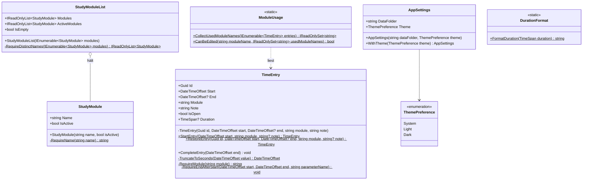

**`TimeEntry` ist der Kern des Kerns.** Vier Dinge sind an ihm bemerkenswert:

- **Der offene Eintrag hat kein eigenes Statusfeld.** Ein Eintrag *ist* offen, wenn `End` fehlt.
  Ein zweites Feld daneben könnte dem widersprechen, dieses nicht.
- **Von außen lässt sich nur das Ende ändern**, und nur über `CompleteEntry`. Der Konstruktor ist
  privat; es gibt genau zwei Wege hinein, `StartEntry` für einen neuen Eintrag und `RestoreEntry`
  für einen aus der Datei gelesenen. Ein abgeschlossener Eintrag kann dadurch nicht versehentlich
  ein zweites Mal beendet werden.
- **Die Dauer wird bei jedem Zugriff frisch gerechnet** und nirgends gehalten. Die Regel aus
  `DATENFORMAT.md` — maßgeblich sind Start und Ende, die Dauer ist nur eine Bequemlichkeit für
  den Menschen — ist damit nicht bloß einzuhalten, sondern unumgehbar.
- **Zeitpunkte werden auf die Sekunde gekürzt**, sobald sie hereinkommen. Die Systemuhr liefert
  sieben Nachkommastellen, die Datei kennt keine. Gekürzt wird deshalb hier und nicht erst beim
  Schreiben, damit die laufende Anzeige keine andere Dauer zeigt als die Datei später.

**`ModuleUsage` ist die Antwort auf eine einzige Frage:** Darf dieses Modul noch umbenannt oder
gelöscht werden? Es darf, solange kein Zeiteintrag seinen Namen trägt — denn der Name steht in
jedem Eintrag im Klartext. Deshalb liest `ModuleUsage` die Einträge, nicht die Modul-Liste.

**`AppSettings` ist unveränderlich.** Eine geänderte Darstellung entsteht nicht durch Zuweisung,
sondern als neues Exemplar über `WithTheme`.

## A3. Der Bereich Speicher

Elf Typen. Sie übersetzen zwischen den Modelltypen und den drei Dateien und sind die einzige
Stelle im Programm, die die Platte anfasst.

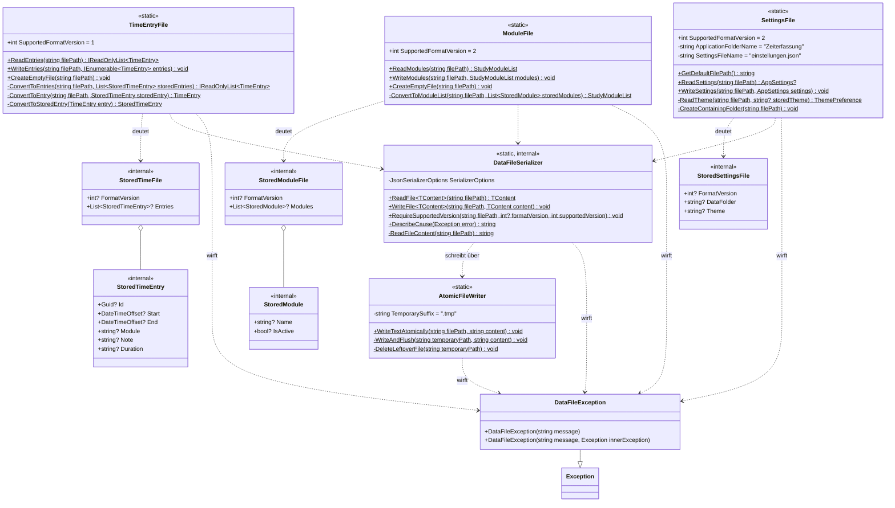

**Die drei Dateiklassen sehen gleich aus, weil sie dieselbe Aufgabe haben.** Jede liest, jede
schreibt, jede nennt ihre eigene `SupportedFormatVersion` — `zeiten.json` steht auf 1,
`module.json` und `einstellungen.json` auf 2. Die Zahl steht bei der Klasse, die die Datei deutet,
und nirgends sonst.

**`DataFileSerializer` ist die gemeinsame Mitte.** Er kennt die JSON-Einstellungen, die für alle
drei Dateien gelten. Zwei davon sind Absicht und keine Bequemlichkeit:

- **Ein unbekanntes Feld lässt die Datei scheitern** (`UnmappedMemberHandling.Disallow`). Eine
  Erweiterung des Formats kostet damit zwingend einen Sprung der Formatversion — sie kann nicht
  stillschweigend geschehen.
- **Die Datei wird eingerückt geschrieben** (`WriteIndented`). Sie soll von Hand lesbar und
  reparierbar bleiben; das ist ein Kernanliegen des Projekts, kein Schönheitswunsch.

`RequireSupportedVersion` ist die Prüfung, die jede der drei Dateiklassen unmittelbar nach dem
Einlesen aufruft: **keine Angabe oder eine andere Zahl heißt Ablehnung**, nicht Deutungsversuch.

**`AtomicFileWriter` ist die Absturzsicherung.** Er schreibt in eine Nebendatei mit der Endung
`.tmp`, drückt sie mit `Flush(flushToDisk: true)` bis auf die Platte durch und benennt sie erst
dann um. Das Umbenennen ist unteilbar: Entweder liegt die neue Datei vollständig da, oder die alte
bleibt unversehrt. Scheitert das Schreiben, wird die Nebendatei weggeräumt — und wenn auch das
scheitert, bleibt sie liegen, ohne den eigentlichen Fehler zu verdecken.

**`DataFileException` ist die einzige Ausnahme, die dieser Bereich nach außen lässt.** Alles, was
darunter passiert — fehlende Datei, kaputtes JSON, gesperrte Datei, ein Eintrag ohne Kennung —,
wird darin gefasst, mit einer Meldung in ganzen Sätzen. Die Schale fängt genau diesen einen Typ
und zeigt seine Meldung unverändert an.

## A4. Die Bereiche Ablauf und Auswertung

Acht Typen: zwei, die den Betrieb führen, und sechs, die rechnen.

```mermaid
classDiagram
    direction TB

    class Workspace {
        -string TimeFileName = "zeiten.json"
        -string ModuleFileName = "module.json"
        +string DataFolder
        +string TimeFilePath
        +string ModuleFilePath
        -Workspace(string dataFolder)
        +OpenWorkspace(string settingsFilePath)$ Workspace?
        +CreateWorkspace(string settingsFilePath, string dataFolder, ThemePreference theme)$ Workspace
        +ReadModules() StudyModuleList
        +WriteModules(StudyModuleList modules) void
        +ReadEntries() IReadOnlyList~TimeEntry~
        +WriteEntries(IEnumerable~TimeEntry~ entries) void
        -RequireExistingFolder() void
        -RequireExistingFiles() void
        -CreateMissingFiles() void
    }

    class TimeTracker {
        -Workspace _workspace
        -TimeProvider _timeProvider
        -TimeEntry? _runningEntry
        +bool IsTracking
        +TimeEntry? RunningEntry
        +TimeTracker(Workspace workspace, TimeProvider timeProvider)
        +FindOpenEntry() TimeEntry?
        +StartTracking(string module, string? note) TimeEntry
        +StopTracking() TimeEntry
        +ResumeTracking(TimeEntry openEntry) void
        +CompleteOpenEntry(TimeEntry openEntry, DateTimeOffset end) TimeEntry
        +GetElapsedTime() TimeSpan
        -CompleteEntryInFile(Guid entryId, DateTimeOffset end) TimeEntry
    }

    class TimeReport {
        <<static>>
        +SummarizeByModule(IEnumerable~TimeEntry~ entries, DateRange range, StudyModuleList? knownModules, ModuleFilter? moduleFilter)$ IReadOnlyList~ModuleTotal~
        +SummarizeByWeek(IEnumerable~TimeEntry~ entries, DateRange range, ModuleFilter? moduleFilter)$ IReadOnlyList~PeriodTotal~
        +SummarizeByDay(IEnumerable~TimeEntry~ entries, DateRange range, ModuleFilter? moduleFilter)$ IReadOnlyList~PeriodTotal~
        +ComputeAverage(IReadOnlyList~PeriodTotal~ totals)$ TimeSpan
        +SelectRecentEntries(IEnumerable~TimeEntry~ entries, DateRange range, ModuleFilter? moduleFilter)$ IReadOnlyList~TimeEntry~
        +GetWeekStart(DateOnly day)$ DateOnly
        -SummarizePeriods(entries, range, moduleFilter, findPeriodStart, findNextPeriod)$ IReadOnlyList~PeriodTotal~
        -CreatePeriodTotal(DateOnly periodStart, IEnumerable~TimeEntry~ group)$ PeriodTotal
        -FillGaps(Dictionary~DateOnly, PeriodTotal~ totals, Func findNextPeriod)$ IReadOnlyList~PeriodTotal~
        -SelectCompletedEntries(IEnumerable~TimeEntry~ entries, DateRange range, ModuleFilter? moduleFilter)$ IEnumerable~TimeEntry~
        -CreateModuleTotal(IGrouping group, Dictionary~string, string~ knownSpellings)$ ModuleTotal
        -CollectKnownSpellings(StudyModuleList? knownModules)$ Dictionary~string, string~
        -SumDurations(IEnumerable~TimeEntry~ entries)$ TimeSpan
        -SumDurations(IEnumerable~TimeSpan~ durations)$ TimeSpan
    }

    class ModuleFilter {
        -HashSet~string~ _modules
        +ModuleFilter All$
        +bool IsActive
        +ModuleFilter(IEnumerable~string~ modules)
        +Matches(TimeEntry entry) bool
    }

    class DateRange {
        +DateRange Everything$
        +DateOnly? From
        +DateOnly? To
        +bool IsUnbounded
        -DateRange(DateOnly? from, DateOnly? to)
        +CreateRange(DateOnly? from, DateOnly? to)$ DateRange
        +ContainsEntry(TimeEntry entry) bool
    }

    class ModuleTotal {
        +string Module
        +TimeSpan Total
        +int EntryCount
        +bool IsKnownModule
        +ModuleTotal(string module, TimeSpan total, int entryCount, bool isKnownModule)
    }

    class PeriodTotal {
        +DateOnly PeriodStart
        +TimeSpan Total
        +int EntryCount
        +IReadOnlyDictionary~string, TimeSpan~ ModuleTimes
        +bool IsEmpty
        +PeriodTotal(DateOnly periodStart, TimeSpan total, int entryCount, IReadOnlyDictionary moduleTimes)
    }

    class CsvExport {
        <<static>>
        -string LineEnding
        -string DecimalHoursPattern = "0.####"
        -string[] Headers
        +BuildEntryCsv(IEnumerable~TimeEntry~ entries, DateRange range, CultureInfo culture, ModuleFilter? moduleFilter)$ string
        +CountExportedEntries(IEnumerable~TimeEntry~ entries, DateRange range, ModuleFilter? moduleFilter)$ int
        +CountSkippedEntries(IEnumerable~TimeEntry~ entries, DateRange range, ModuleFilter? moduleFilter)$ int
        -SelectExportableEntries(IEnumerable~TimeEntry~ entries, DateRange range, ModuleFilter? moduleFilter)$ IEnumerable~TimeEntry~
        -BuildFields(TimeEntry entry, CultureInfo culture)$ string[]
        -AppendRow(StringBuilder builder, IReadOnlyList~string~ fields, string separator)$ void
        -EscapeField(string field, string separator)$ string
    }

    TimeTracker --> Workspace : liest und schreibt durch
    TimeTracker ..> TimeEntry
    Workspace ..> TimeEntryFile
    Workspace ..> ModuleFile
    Workspace ..> SettingsFile

    TimeReport ..> DateRange : filtert mit
    TimeReport ..> ModuleFilter : filtert mit
    TimeReport ..> ModuleTotal : liefert
    TimeReport ..> PeriodTotal : liefert
    CsvExport ..> DateRange : filtert mit
    CsvExport ..> ModuleFilter : filtert mit
    CsvExport ..> DurationFormat
    ModuleFilter ..> TimeEntry : prüft
    DateRange ..> TimeEntry : prüft
```

**`Workspace` ist der gewählte Ordner, als Objekt.** Er kennt die beiden Dateinamen und setzt sie
mit dem Ordnerpfad zusammen; außerhalb dieser Klasse kommen `zeiten.json` und `module.json` im
ganzen Programm nicht vor. Die beiden Einstiege unterscheiden sich in einem Punkt:

- **`OpenWorkspace`** liest die Einstellungen. Gibt es keine, liefert es `null` — das ist das
  Zeichen für den ersten Start auf diesem Rechner und kein Fehler. Gibt es sie, müssen Ordner
  *und* beide Dateien vorhanden sein, sonst folgt eine `DataFileException` mit dem Hinweis, dass
  OneDrive vielleicht noch nicht fertig ist.
- **`CreateWorkspace`** verlangt einen vorhandenen Ordner, legt fehlende Dateien leer an und
  schreibt danach erst die Einstellungen. Die Reihenfolge ist Absicht: Ein gemerkter Pfad, unter
  dem nichts liegt, wäre schlimmer als gar keiner.

**`TimeTracker` führt die Sitzung.** Er hält den laufenden Eintrag im Speicher, aber er verlässt
sich nicht darauf: `StartTracking` und das Abschließen lesen die Datei jedes Mal frisch ein,
ändern die Liste und schreiben sie ganz zurück. Das ist die Antwort darauf, dass die Datei über
OneDrive wandert — was zwischenzeitlich vom anderen Rechner kam, geht so nicht verloren.

`FindOpenEntry` ist zugleich eine Prüfung: **Mehr als ein Eintrag ohne Ende ist ein Fehler**, kein
Zustand, den die App zu deuten versucht. Sie sagt es und verlangt Handarbeit an der Datei.

Die Uhr kommt von außen, als `TimeProvider`. Im Betrieb ist das `TimeProvider.System`, in den
Tests eine gestellte Uhr — deshalb lassen sich Dauern prüfen, ohne zu warten.

**`TimeReport` rechnet, ohne etwas anzuzeigen.** Vier Auswertungen, alle nach demselben Muster:
Zeitraum filtern, offene Einträge auslassen, gruppieren, summieren. Drei Feinheiten:

- **Offene Einträge zählen nirgends mit.** Sie haben keine Dauer. Das Auswertungsfenster weist
  gesondert darauf hin, dass eine Sitzung läuft.
- **Lücken werden gefüllt** (`FillGaps`). Eine Woche ohne Eintrag zwischen zwei Wochen mit
  Einträgen erscheint mit null Stunden statt zu fehlen — sonst zeigte das Diagramm einen falschen
  Verlauf.
- **Module werden nach Groß- und Kleinschreibung zusammengefasst**, aber unter der Schreibweise
  aus `module.json` ausgewiesen, solange das Modul dort noch steht. Steht es nicht mehr dort,
  gewinnt die Schreibweise des jüngsten Eintrags, und `IsKnownModule` ist falsch — das Fenster
  vermerkt dann „steht nicht mehr in module.json".

**`DateRange` vergleicht nur den Starttag.** Eine Sitzung über Mitternacht gehört damit ganz zu
dem Tag, an dem sie begonnen hat. `Everything` ist der unbeschränkte Zeitraum.

**`ModuleFilter` ist die Auswahl der Module, auf die eine Auswertung beschränkt wird**.
Eine leere Auswahl heißt nicht „kein Modul", sondern „keine Beschränkung" — `All` lässt jeden
Eintrag durch. Verglichen wird ohne Rücksicht auf Groß- und Kleinschreibung. Wochen-, Tages- und
Eintragsauswertung sowie der CSV-Export nehmen den Filter als letzten, wahlfreien Parameter.

**`PeriodTotal` trägt die Aufschlüsselung mit.** `ModuleTimes` hält je Modul die Zeit der Woche
oder des Tages; ein Modul ohne Zeit fehlt im Wörterbuch und gilt als null. Die Werte ergeben
zusammen `Total`. So rechnet `SummarizePeriods` einmal, und Tabelle wie Diagramm lesen dieselben
Zahlen. **`ComputeAverage`** bildet den Mittelwert über alle Zeiträume der Folge — die leeren
dazwischen zählen mit null.

**`CsvExport` richtet sich nach Windows.** Trennzeichen und Dezimalzeichen kommen aus den
Regionseinstellungen, nicht aus dem Code — auf einem deutschen Rechner also Semikolon und Komma,
so wie Excel es dort erwartet. Die Dauer steht doppelt in der Datei: einmal dezimal zum Rechnen,
einmal als Stunden:Minuten:Sekunden zum Lesen.

## A5. Die Schale

Zwölf Typen: vier Fenster, zwei Helfer, vier Zeilen-Typen, eine Aufzählung und die Anwendung
selbst. Die Anbindung erfolgt per Code-Behind — die `Handle…`-Methoden sind die
Ereignisbehandler, die in der XAML eingetragen sind.

```mermaid
classDiagram
    direction TB

    class App {
        -SingleInstanceGuard? _instanceGuard
        #OnStartup(StartupEventArgs eventArguments) void
        #OnExit(ExitEventArgs eventArguments) void
        -ReadStoredTheme()$ ThemePreference
        -HandleUnhandledException(object sender, DispatcherUnhandledExceptionEventArgs e) void
    }

    class SingleInstanceGuard {
        <<internal>>
        -string MutexName = "Local\\Zeiterfassung.SingleInstance"
        -Mutex _mutex
        +bool IsOwner
        +SingleInstanceGuard()
        +ActivateRunningInstance()$ void
        +Dispose() void
        -FindWindowOfRunningInstance()$ IntPtr
        -ReleaseOwnership() void
        -SetForegroundWindow(IntPtr windowHandle)$ bool
        -ShowWindow(IntPtr windowHandle, int command)$ bool
    }

    class AppearanceSetup {
        <<static, internal>>
        -string PersonalizeKeyPath
        -List~Window~ WatchedWindows
        -HashSet~Window~ ActivelyWatched
        -ThemePreference _preference
        +ThemePreference CurrentPreference
        +ApplyTheme(ThemePreference preference)$ void
        +RegisterWindow(Window window)$ void
        -HandleWindowClosed(object? sender, EventArgs e)$ void
        -UpdateWatching(Window window)$ void
        -ResolveTheme(ThemePreference preference)$ ApplicationTheme
        -ReadSystemTheme()$ ApplicationTheme
    }

    class MainWindow {
        -DispatcherTimer _elapsedTimer
        -string _settingsFilePath
        -Workspace? _workspace
        -TimeTracker? _tracker
        -ReportWindow? _reportWindow
        -bool _isCompactMode
        -double _fullWidth
        -double _fullHeight
        +MainWindow()
        -HandleContentRendered(object? sender, EventArgs e) void
        -OpenOrChooseWorkspace() void
        -ChooseDataFolder() void
        -PrepareTracking() void
        -ResolveOpenEntry() void
        -HandlePlayClick(object sender, RoutedEventArgs e) void
        -HandleStopClick(object sender, RoutedEventArgs e) void
        -StopTracking() bool
        -HandleChooseFolderClick(object sender, RoutedEventArgs e) void
        -HandleModuleSelectionChanged(object sender, SelectionChangedEventArgs e) void
        -HandleTimerTick(object? sender, EventArgs e) void
        -HandleWindowClosing(object? sender, CancelEventArgs e) void
        -HandleReportClick(object sender, RoutedEventArgs e) void
        -HandleReportWindowClosed(object? sender, EventArgs e) void
        -HandleCompactClick(object sender, RoutedEventArgs e) void
        -HandleExpandClick(object sender, RoutedEventArgs e) void
        -HandleManageModulesClick(object sender, RoutedEventArgs e) void
        -HandleThemeClick(object sender, RoutedEventArgs e) void
        -HandleThemeChoice(object sender, RoutedEventArgs e) void
        -SaveThemeChoice(ThemePreference chosen) void
        -UpdateThemeMenu() void
        -ReloadModules(string? previousSelection) void
        -SelectModule(string moduleName) void
        -ShowElapsedTime() void
        -ShowStatus(string message) void
        -ShowProblem(string headline, string message, bool offerFolderChoice) void
        -ApplyStatusColors(string backgroundKey, string borderKey, string accentKey) void
        -EnterCompactMode() void
        -LeaveCompactMode() void
        -SetFullViewVisibility(Visibility visibility) void
        -UpdateWindowTitle() void
        -ShortenForTitleBar(string moduleName)$ string
        -UpdateControlState() void
        -UpdateToolTips(bool isTracking) void
    }

    class OpenEntryDialog {
        -string EndInputPattern = "dd.MM.yyyy HH:mm:ss"
        -TimeEntry _openEntry
        +OpenEntryChoice Choice
        +DateTimeOffset ChosenEnd
        +OpenEntryDialog(TimeEntry openEntry)
        -HandleCompleteClick(object sender, RoutedEventArgs e) void
        -HandleResumeClick(object sender, RoutedEventArgs e) void
        -HandleEndInputChanged(object sender, TextChangedEventArgs e) void
        -TryReadEnd(DateTimeOffset end) bool
        -ShowHint(string hint) void
    }

    class OpenEntryChoice {
        <<enumeration>>
        Undecided
        Complete
        Resume
    }

    class ModuleDialog {
        -Workspace _workspace
        -IReadOnlySet~string~ _usedModuleNames
        -List~StudyModule~ _modules
        -bool _isListReadable
        +bool WasChanged
        +ModuleDialog(Workspace workspace)
        -LoadModules() void
        -ShowModules(string? nameToSelect) void
        -HandleSelectionChanged(object sender, SelectionChangedEventArgs e) void
        -HandleNameChanged(object sender, TextChangedEventArgs e) void
        -HandleAddClick(object sender, RoutedEventArgs e) void
        -HandleRenameClick(object sender, RoutedEventArgs e) void
        -HandleDeleteClick(object sender, RoutedEventArgs e) void
        -HandleToggleClick(object sender, RoutedEventArgs e) void
        -SaveModules() bool
        -FindExistingModule(string name) StudyModule?
        -UpdateButtonState() void
        -UpdateToolTips(ModuleEditRow? row, bool hasName, string name) void
        -ShowMessage(string message, SymbolRegular symbol, string colorResourceKey) void
    }

    class ReportWindow {
        -Workspace _workspace
        -SKColor[] ModulePalette$
        -HashSet~string~ _selectedModules
        -Dictionary _moduleColumns
        -List~string~ _filterOptions
        -bool _isUpdatingDates
        -bool _isUpdatingFilter
        +ReportWindow(Workspace workspace)
        -LoadReport() void
        -RefreshFilterOptions(List~string~ names) void
        -RebuildFilterList() void
        -BuildRange() DateRange?
        -ReadModulesIfPossible() StudyModuleList?
        -HandleModuleFilterClick(object sender, RoutedEventArgs e) void
        -HandleAllModulesClick(object sender, RoutedEventArgs e) void
        -HandleModuleCheckChanged(object sender, RoutedEventArgs e) void
        -HandleBreakdownChanged(object sender, RoutedEventArgs e) void
        -HandleChartWheel(object sender, MouseWheelEventArgs e) void
        -HandleThemeChanged(ApplicationTheme currentTheme, Color accentColor) void
        -HandleWindowClosed(object? sender, EventArgs e) void
        -HandleDateChanged(object sender, SelectionChangedEventArgs e) void
        -HandleEverythingClick(object sender, RoutedEventArgs e) void
        -HandleRefreshClick(object sender, RoutedEventArgs e) void
        -HandleExportClick(object sender, RoutedEventArgs e) void
        -AskForTargetPath() string?
        -WriteCsvFile(string targetPath, IReadOnlyList~TimeEntry~ entries, DateRange range, ModuleFilter moduleFilter) void
        -BuildExportNote(string targetPath, IReadOnlyList~TimeEntry~ entries, DateRange range, ModuleFilter moduleFilter)$ string
        -ShowModules(IReadOnlyList~ModuleTotal~ totals) void
        -ShowWeeks(IReadOnlyList~PeriodTotal~ totals, IReadOnlyList~string~ modules) void
        -ShowDays(IReadOnlyList~PeriodTotal~ totals, IReadOnlyList~string~ modules) void
        -ChooseBreakdownModules(IReadOnlyList~string~ modules) IReadOnlyList~string~
        -CreatePeriodRow(string label, PeriodTotal total, IReadOnlyList~string~ modules)$ PeriodRow
        -ConfigureModuleColumns(DataGrid grid, IReadOnlyList~string~ modules) void
        -ShowPeriodChart(CartesianChart chart, IReadOnlyList~PeriodTotal~ totals, IReadOnlyList~string~ modules, Func formatLabel, double labelsRotation) void
        -PickModuleColor(string module) SKColor
        -ShowEntries(IReadOnlyList~TimeEntry~ entries, DateRange range, ModuleFilter filter) void
        -ShowSummary(IReadOnlyList~ModuleTotal~ totals, DateRange range) void
        -ShowOpenEntry(IReadOnlyList~TimeEntry~ entries) void
        -CreateHourAxis() Axis
        -CreateLabelAxis(IReadOnlyList~string~ labels, double labelsRotation) Axis
        -ApplyChartTheme(CartesianChart chart) void
        -ReadThemeColor(string resourceKey, SKColor fallback) SKColor
        -CreateEntryRow(TimeEntry entry)$ EntryRow
        -FormatHours(double hours)$ string
        -FormatWeek(DateOnly weekStart)$ string
        -FormatShortWeek(DateOnly weekStart)$ string
        -FormatDay(DateOnly day)$ string
        -FormatShortDay(DateOnly day)$ string
        -FormatRange(DateRange range)$ string
        -ToDateOnly(DateTime? value)$ DateOnly?
        -ShowProblem(string message) void
        -ShowNote(string message) void
        -ShowMessage(string message, string colorResourceKey) void
        -HideMessage() void
    }

    class ModuleRow {
        +string Module
        +string Total
        +int EntryCount
        +string Hint
        +ModuleRow(string module, string total, int entryCount, string hint)
    }

    class PeriodRow {
        +string Period
        +string Total
        +int EntryCount
        +string[] ModuleTimes
        +PeriodRow(string period, string total, int entryCount, string[] moduleTimes)
    }

    class EntryRow {
        +string Day
        +string Period
        +string Module
        +string Note
        +string Duration
        +EntryRow(string day, string period, string module, string note, string duration)
    }

    class ModuleEditRow {
        +string Name
        +bool IsActive
        +bool IsUsed
        +string State
        +string Usage
        +ModuleEditRow(string name, bool isActive, bool isUsed)
    }

    App --|> Application
    MainWindow --|> FluentWindow
    ReportWindow --|> FluentWindow
    OpenEntryDialog --|> FluentWindow
    ModuleDialog --|> FluentWindow
    SingleInstanceGuard ..|> IDisposable

    App --> SingleInstanceGuard : hält
    App --> MainWindow : öffnet
    App ..> AppearanceSetup

    MainWindow --> ReportWindow : hält, solange offen
    MainWindow ..> OpenEntryDialog : modal
    MainWindow ..> ModuleDialog : modal
    MainWindow ..> AppearanceSetup
    OpenEntryDialog --> OpenEntryChoice : antwortet mit
    ModuleDialog ..> ModuleEditRow : füllt
    ReportWindow ..> ModuleRow : füllt
    ReportWindow ..> PeriodRow : füllt
    ReportWindow ..> EntryRow : füllt
    ReportWindow ..> AppearanceSetup
    ModuleDialog ..> AppearanceSetup
```

**Alle vier Fenster erben von `FluentWindow`**, nicht von `Window` — das kommt mit WPF-UI
 und ist der Grund, warum die Fenster eine eigene Titelleiste zeichnen und der Wechsel
zwischen heller und dunkler Darstellung überhaupt möglich ist.

**`App` tut beim Start drei Dinge in dieser Reihenfolge**: die zweite Instanz abwehren, die
gespeicherte Darstellung anwenden, das Hauptfenster öffnen. Die Reihenfolge ist wichtig — das
Fenster soll nicht erst hell aufblitzen und dann dunkel werden. Scheitert das Lesen der
Einstellungen, fällt die Darstellung stillschweigend auf *System* zurück; eine Fehlermeldung vor
dem ersten Fenster wäre hier fehl am Platz, und dieselbe Datei wird gleich darauf ordentlich
gelesen und gemeldet.

**`SingleInstanceGuard` ist ein benanntes Sperrobjekt des Betriebssystems** (ein Mutex mit dem
Präfix `Local\`, also je Windows-Sitzung). Wer es nicht bekommt, ist der zweite Start: Er sucht
das Fenster des ersten, holt es nach vorn und beendet sich wortlos. Der Vorteil eines Mutex
gegenüber einer Sperrdatei ist, dass ein Absturz ihn nicht überdauert.

**`AppearanceSetup` bindet die Darstellung an Windows — oder gerade nicht.** Steht die Wahl auf
*System*, wird jedes Fenster bei WPF-UI zur Beobachtung angemeldet und zieht bei einer Umstellung
im laufenden Betrieb mit. Bei *Hell* oder *Dunkel* wird die Beobachtung ausdrücklich abgemeldet —
sonst überschriebe Windows die Wahl beim nächsten Wechsel. Die Klasse führt darum zwei Listen: die
bekannten Fenster und die davon gerade beobachteten.

**`MainWindow` ist das größte Stück Schale**, weil es alles zusammenhält: Ordnerwahl, Modul-Liste,
Play und Stop, die laufende Uhr, die beiden Dialoge, das Auswertungsfenster, den Kompaktmodus und
das Menü für die Darstellung. Fachlich entscheidet es nichts — jeder dieser Wege endet in einem
Aufruf in den Kern. Zwei Muster wiederholen sich:

- **`UpdateControlState` und `UpdateToolTips` sind der einzige Ort, an dem Knöpfe gesperrt und
  entsperrt werden.** Nach jeder Zustandsänderung wird der ganze Satz neu bestimmt, statt einzelne
  Knöpfe an Ort und Stelle umzuschalten. Jeder gesperrte Knopf sagt in seinem Tooltip, warum.
- **`ShowStatus` und `ShowProblem` sind der einzige Ort, an dem etwas gemeldet wird.** Eine Meldung
  holt dabei die große Ansicht zurück — im Kompaktmodus wäre sie nicht zu sehen.

**`ReportWindow` ist nicht modal**: Die Erfassung läuft weiter, während man
hineinsieht. Es liest bei jedem `LoadReport` frisch aus der Datei und rechnet nichts selbst; alle
Summen kommen aus `TimeReport`. Der Löwenanteil seiner Methoden ist Formatierung und
Diagrammaufbau. **Der Modulfilter** (`_selectedModules`) wirkt auf Wochen, Tage, Einträge, die
Gesamtzeile und den CSV-Export, nicht auf den Reiter *Module*; die Liste der Häkchen
(`RefreshFilterOptions`) wird nur neu gebaut, wenn sich die Menge der Module ändert, damit sie sich
nicht unter der Maus verändert. **Der Umschalter *Je Modul / Nur Summe*** entscheidet, ob
`ShowWeeks` und `ShowDays` Module als eigene Säulen und Tabellenspalten bekommen. Hat nur ein
Modul eine eigene Säule, lässt `ShowPeriodChart` die Summensäule weg, weil sie gleich hoch
wäre; die Tabelle behält ihre Spalten. Eine
Besonderheit: **Die Diagramme müssen bei einem Wechsel der Darstellung neu
gezeichnet werden**, weil LiveCharts2 mit fest übergebenen Farben zeichnet und nicht mit denen des
Themes — sonst stünde die Achsenbeschriftung schwarz auf schwarzem Grund.

**`ModuleDialog` sperrt sich selbst, wenn er die Liste nicht lesen kann.** Steht `_isListReadable`
auf falsch, ist jeder Knopf gesperrt — ein Schreiben würde die Module, die in der unlesbaren Datei
stehen, unwiederbringlich überschreiben. Was mit einem Modul möglich ist, entscheidet nicht dieser
Dialog, sondern `zeiten.json`: `ModuleUsage` sagt, ob darauf schon Zeit gebucht ist.

---

# Teil B — Die Abläufe

Sechs Abläufe, einer je Diagramm. Die Art richtet sich danach, worauf es beim jeweiligen Ablauf
ankommt: **Flussdiagramme**, wo die Verzweigungen die Sache sind, **Sequenzdiagramme**, wo das
Zusammenspiel zwischen Schale, Kern und Datei erklärungsbedürftig ist.

| Nr. | Ablauf | Art | Warum diese Art |
|---|---|---|---|
| B1 | Der Programmstart | Flussdiagramm | Sieben Wege führen vom Start zum bedienbaren Fenster |
| B2 | Der offene Eintrag | Flussdiagramm | Eine Entscheidung des Benutzers mit drei Ausgängen |
| B3 | Von Play bis Stop | Sequenzdiagramm | Was dabei auf die Platte geht, ist der Kern der Sache |
| B4 | Auswerten und ausgeben | Sequenzdiagramm | Zusammenspiel zweier Fenster mit derselben Datei |
| B5 | Module pflegen | Flussdiagramm | Was erlaubt ist, hängt vom Zustand ab |
| B6 | Die Darstellung wählen | Flussdiagramm | Die Abzweigung *System* verhält sich anders als die festen |

## B1. Der Programmstart

Vom Doppelklick bis zum bedienbaren Fenster. Der Ablauf hat sieben Ausgänge, von denen nur einer
der Normalfall ist.

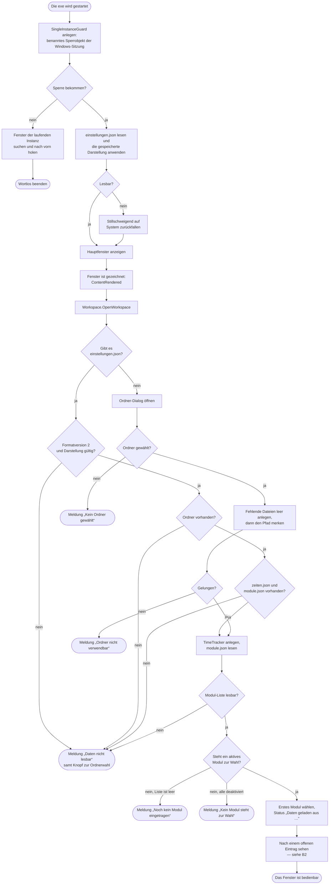

**Die Prüfung auf die zweite Instanz steht ganz vorn**, noch vor jedem Fenster. Zwei Instanzen
arbeiteten auf zwei unabhängigen Ständen derselben `zeiten.json`, und die zweite überschriebe die
Arbeit der ersten. Das Sperrobjekt trägt den Präfix `Local\`, gilt also je Windows-Sitzung, und
überdauert einen Absturz nicht.

**Die Darstellung wird vor dem Fenster angewendet**, damit es nicht erst hell aufblitzt und dann
dunkel wird. Scheitert das Lesen hier, wird nichts gemeldet — dieselbe Datei wird Sekunden später
von `OpenWorkspace` noch einmal gelesen, und dort gehört die Meldung hin.

**Der Ordner-Dialog ist kein Fehlerfall, sondern der erste Start.** `OpenWorkspace` liefert
`null`, wenn es die Einstellungsdatei nicht gibt; erst wenn sie da ist und nicht passt, wird
abgelehnt.

**Die Reihenfolge beim Anlegen ist Absicht:** erst die Dateien, dann der gemerkte Pfad. Ein Pfad,
unter dem nichts liegt, wäre schlimmer als gar keiner.

**Vier der sieben Ausgänge sind Meldungen** — und sie unterscheiden sich in einem Punkt, der leicht
zu übersehen ist: Bei „Daten nicht lesbar", „Kein Ordner gewählt" und „Ordner nicht verwendbar"
steht ein Knopf zur Ordnerwahl darunter, denn dort liegt die Abhilfe. Bei den beiden Meldungen zur
Modul-Liste fehlt er: Der Datenordner ist in Ordnung, der Weg führt über die Modulpflege (B5).

## B2. Der offene Eintrag

Ein Eintrag ohne Endzeitpunkt bedeutet: Beim letzten Mal wurde nicht gestoppt — die App ist
abgestürzt, oder es wurde ohne Stop zum anderen Rechner gewechselt. Die App entscheidet das nicht
selbst, sondern legt beide Wege vor.

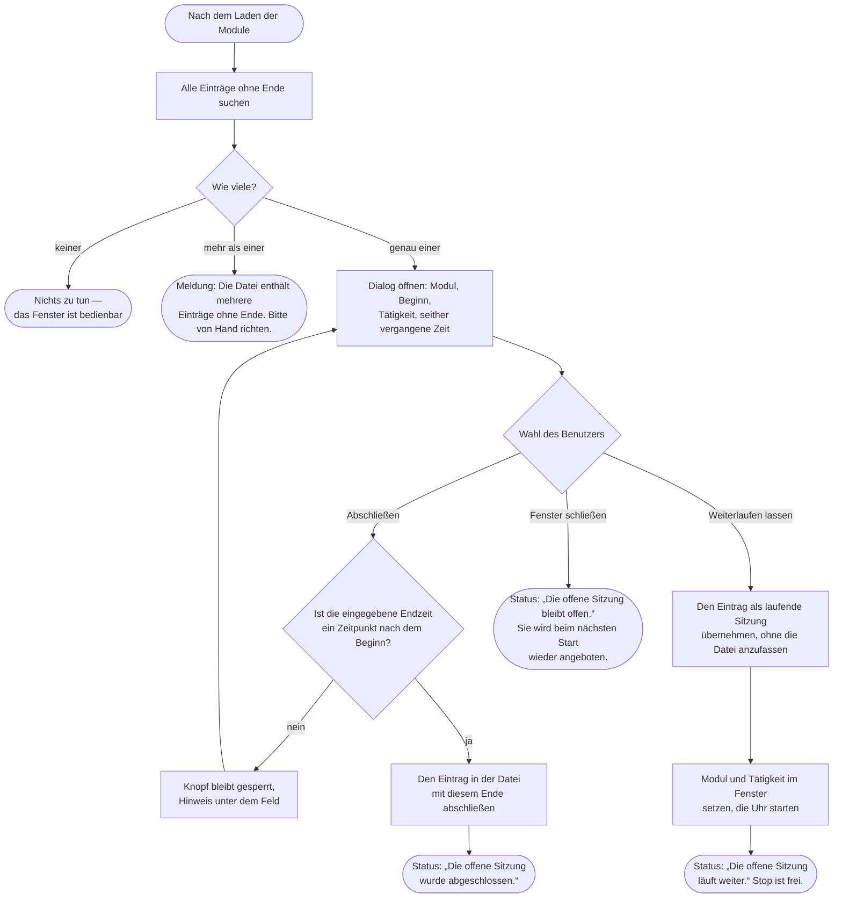

**Mehr als ein offener Eintrag ist ein Fehler, kein Zustand.** Die App könnte raten, welcher
gemeint ist — sie tut es nicht, sondern verlangt Handarbeit an der Datei. Dass das zumutbar ist,
ist die Voraussetzung, unter der `zeiten.json` lesbar und reparierbar gehalten wird.

**Die beiden Wege unterscheiden sich darin, ob geschrieben wird.** *Abschließen* ändert die Datei
sofort: Der Eintrag bekommt sein Ende, die Datei wird ganz neu geschrieben. *Weiterlaufen lassen*
fasst die Datei überhaupt nicht an — der offene Eintrag bleibt offen, die App übernimmt ihn nur
als laufende Sitzung. Geschrieben wird dann erst beim Stop.

**Das Wegklicken des Dialogs ist ein gültiger dritter Weg.** Wer sich nicht entscheiden will,
bekommt die Frage beim nächsten Start wieder. Nichts geht dabei verloren.

**Die Endzeit wird beim Tippen geprüft**, nicht erst beim Klick: Solange die Eingabe kein
Zeitpunkt nach dem Beginn ist, bleibt der Knopf gesperrt und sagt in seinem Tooltip, warum.

## B3. Von Play bis Stop

Der Weg, um den es in der App eigentlich geht — und derjenige, bei dem am meisten auf die Platte
geht. Die drei Spalten rechts sind Kern, die beiden links sind Schale.

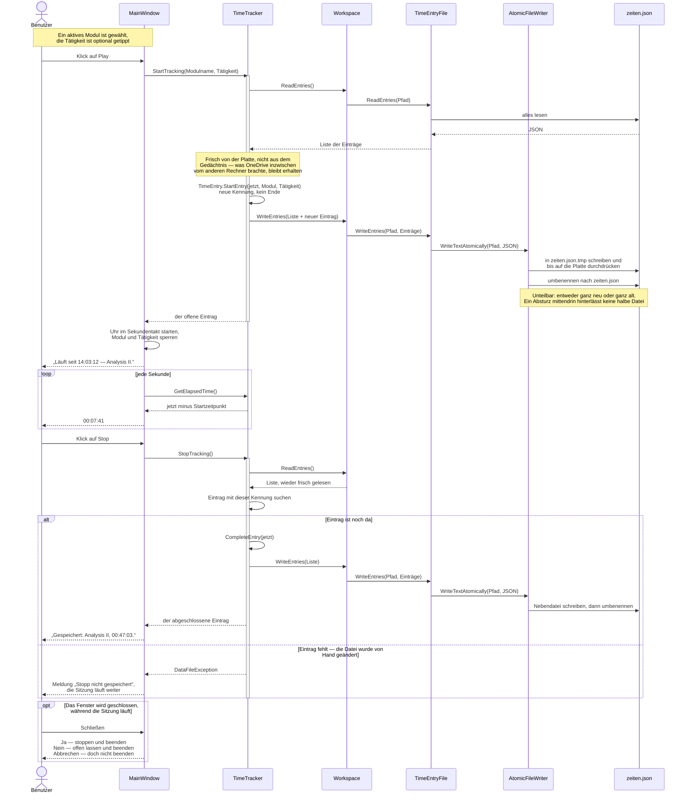

**Play schreibt sofort.** Das ist die erste der beiden Absturzsicherungen: Eine begonnene Sitzung
steht auf der Platte, bevor irgendetwas schiefgehen kann. Stürzt die App danach ab, ist der
Eintrag offen — und offene Einträge kann die App beim nächsten Start behandeln (B2).

**Vor jedem Schreiben wird frisch gelesen.** Der `TimeTracker` hält den laufenden Eintrag zwar im
Gedächtnis, aber er verlässt sich beim Schreiben nicht darauf. Weil die Datei über OneDrive
wandert und weil sie bei jeder Änderung ganz neu geschrieben wird, ginge sonst verloren, was
zwischenzeitlich vom anderen Rechner kam.

**Das Schreiben selbst ist die zweite Absturzsicherung.** Nebendatei, durchdrücken, umbenennen —
das Umbenennen ist der einzige unteilbare Schritt, und deshalb ist er der letzte.

**Der Fehlerfall beim Stop ist echt und nicht theoretisch.** Wird `zeiten.json` von Hand
bearbeitet, während die App läuft, kann der Eintrag mit der gemerkten Kennung verschwunden sein.
Die App meldet das und lässt die Sitzung laufen, statt sie stillschweigend zu verlieren.

**Die laufende Uhr rechnet, sie zählt nicht.** Jeder Tick fragt nach der Differenz zwischen jetzt
und dem Startzeitpunkt. Ein ausgefallener Tick — etwa während der Rechner schläft — verfälscht
die Anzeige deshalb nicht.

## B4. Auswerten und ausgeben

Das Auswertungsfenster ist **nicht modal**: Die Erfassung läuft weiter, während man
hineinsieht. Es liest, es rechnet nicht selbst, und es schreibt nie in die Datendateien.

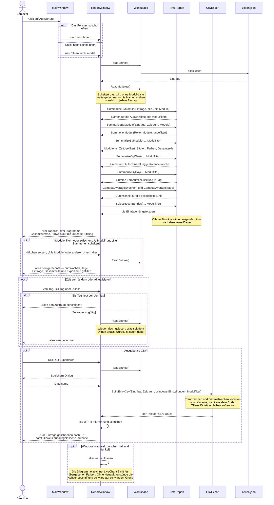

**Es gibt immer höchstens ein Auswertungsfenster.** Ein zweiter Klick holt das vorhandene nach
vorn. Das ist keine Kosmetik: Zwei Fenster, die dieselbe Datei lesen, wären harmlos — aber das
Hauptfenster hält nur eines von ihnen fest und wüsste nach dem Schließen nicht, welches noch
offen ist.

**Gelesen wird bei jeder Gelegenheit neu**, beim Öffnen wie bei jeder Änderung des Zeitraums. So
taucht eine Sitzung, die im Hauptfenster gerade gestoppt wurde, nach einem Klick auf Aktualisieren
sofort in den Summen auf.

**Die Modul-Liste ist entbehrlich, die Einträge sind es nicht.** Lässt sich `module.json` nicht
lesen, rechnet das Fenster trotzdem — die Modulnamen stehen ja im Klartext in jedem Eintrag. Es
kann dann nur nicht mehr sagen, welches Modul noch in der Liste steht und welches nicht.

**Der Export führt nur hinaus.** Eine geänderte CSV-Datei wieder einzulesen ist nicht vorgesehen
und wird es nicht.

## B5. Module pflegen

Erreichbar über das Bücherregal-Symbol in der Titelleiste, gesperrt während einer laufenden
Sitzung. Was mit einem Modul möglich ist, entscheidet nicht der Dialog, sondern `zeiten.json`.

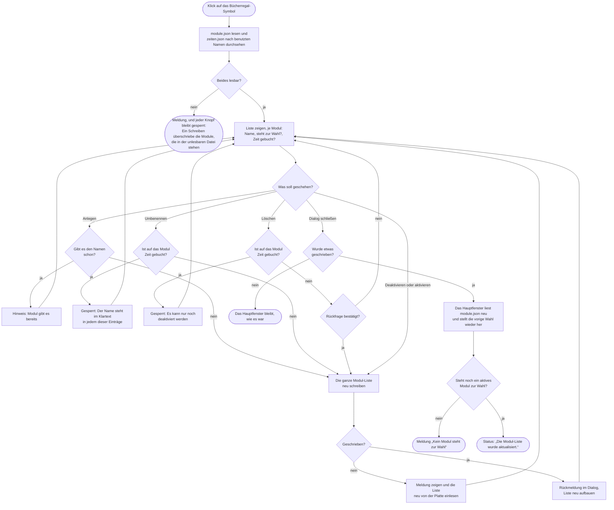

**Die Grenze verläuft zwischen benutzt und unbenutzt.** Ein Modul ohne jeden Zeiteintrag ist frei
umbenennbar und löschbar. Sobald ein Eintrag darauf läuft, steht sein Name im Klartext in der
Erfassungsdatei — dann bleibt nur noch *deaktivieren*: Es verschwindet aus der Auswahl und zählt
in der Auswertung weiter mit. Jeder gesperrte Knopf sagt in seinem Tooltip, welcher der beiden
Gründe vorliegt.

**Geschrieben wird nach jeder einzelnen Änderung**, nicht erst beim Schließen. Der Dialog hat
deshalb kein „Abbrechen": Was er zeigt, steht bereits in der Datei.

**Scheitert das Schreiben, liest der Dialog neu ein.** Sonst zeigte er einen Stand, den es auf
der Platte nicht gibt — und die nächste Änderung schriebe ihn fest.

**Die Datei bleibt daneben von Hand bearbeitbar.** Beide Wege bestehen nebeneinander; der Dialog
hat kein Vorrecht auf `module.json`. Weil die Datei aber **wandert**, müssen beide Rechner auf
Formatversion 2 sein, bevor ein Modul in der App gepflegt wird.

## B6. Die Darstellung wählen

Drei Möglichkeiten im Menü der Titelleiste: *Wie das System*, *Immer hell*, *Immer dunkel*. Die
Wahl wirkt sofort, überdauert den Neustart und gilt je Rechner.

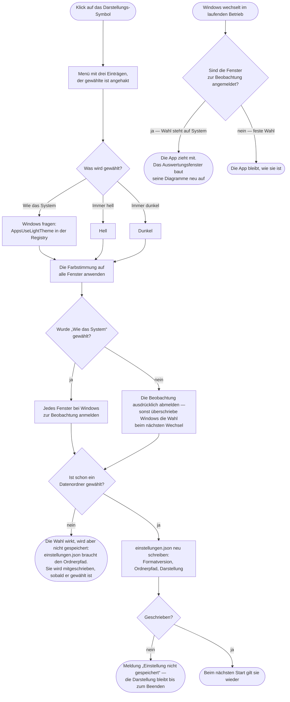

**Die Wahl *System* ist kein dritter Farbwert, sondern ein Abonnement.** Bei *Hell* und *Dunkel*
steht die Farbe fest; bei *System* wird die Farbstimmung von Windows übernommen **und** jedes
Fenster für spätere Wechsel angemeldet. Genau deshalb muss beim Wechsel auf eine feste Wahl
ausdrücklich abgemeldet werden — die Anmeldung bliebe sonst bestehen und überschriebe die Wahl
beim nächsten Wechsel von Windows.

**Die Anmeldung geschieht je Fenster, nicht je App.** `AppearanceSetup` führt darum zwei Listen:
alle bekannten Fenster und die davon gerade beobachteten. Jedes neue Fenster meldet sich beim
Öffnen an und wird beim Schließen aus beiden Listen entfernt.

**Vor dem ersten Ordner wird nichts gespeichert.** `einstellungen.json` enthält den Ordnerpfad und
die Darstellung zusammen; ohne Ordner gäbe es nichts, wohin die Datei gehörte. Die Wahl wirkt
trotzdem sofort und wird beim Anlegen des Ordners mitgeschrieben — deshalb reicht die Ordnerwahl
die aktuelle Einstellung an `CreateWorkspace` durch.

**Farben stehen nirgends fest im Code.** Sie werden immer als Ressourcenverweis gesetzt, in der
XAML mit `DynamicResource`, im Code mit `SetResourceReference`. Eine fest eingetragene Farbe
überstünde den Wechsel nicht. Die einzige Ausnahme sind die Diagramme: LiveCharts2 zeichnet mit
fest übergebenen Farben, die das Auswertungsfenster bei jedem Wechsel neu aus dem Theme liest.
