# Diagrams — MagieSoft TimeTracking

> **English version of `docs/DIAGRAMME.md`, reflecting the German original as of 27 October
> 2026.** The German version is authoritative; where the two differ, it applies. Document names
> below refer to the German originals in `docs/`; four of them also exist in English in this
> folder. Messages the app shows are quoted in German, as they appear on screen, with a
> translation alongside.

> This document lays open the classes and flows of the app completely. It is addressed to a
> **third party** who does not know the code and does not want to read it either. What is written
> here is meant to be understandable without a look at the source.
>
> The diagrams are written in **Mermaid**. GitHub renders them directly; in an editor without
> Mermaid support they remain readable text. Every diagram has a paragraph of prose before or
> after it — whoever dislikes the notation gets by without it.
>
> The big picture is in `ARCHITECTURE.md`, the fields of the files in `DATENFORMAT.md`, the
> behaviour of the interface in `OBERFLAECHE.md`. This document repeats only as much of that as is
> needed to understand the diagrams.

## Contents

**Part A — the classes.** An overview diagram with all 38 types, then four diagrams, each showing
one area with all its members.

**Part B — the flows.** Six diagrams, one per flow.

---

# Part A — The classes

The app consists of **38 types**: 26 in the logic core and 12 in the WPF shell. The core falls into
four namespaces — model, storage, workflow and reporting —, the shell is flat.

The division follows one rule: **the core does not know the shell.** Every arrow between the two
projects points from the shell to the core, none back. The same holds downwards within the core:
the model knows nothing of storage, storage nothing of the workflow.

## A1. Overview of all types

This diagram names only the types and their relationships. The members are in the four diagrams
after it.

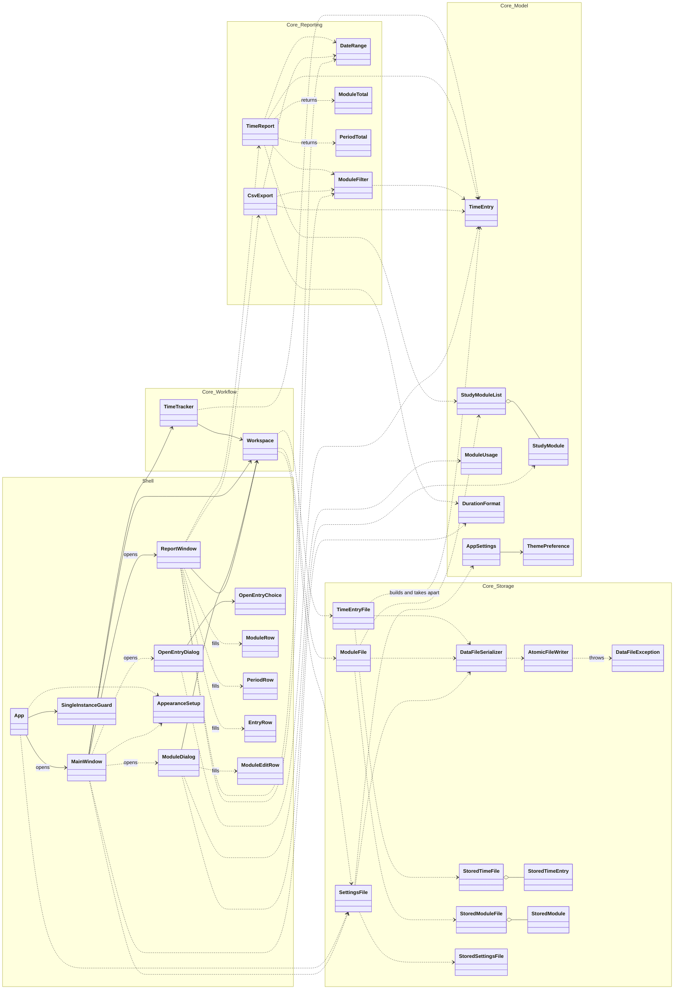

Three things can be read from it:

**The shell depends on the core, never the other way round.** All arrows between the two blocks
point left. That is why the core can be tested without a window, and why `ARCHITECTURE.md` says it
knows neither shell nor tests.

**Storage has a double layer.** For every model type there is a `Stored…` twin. The model types
validate themselves and cannot be created in a contradictory state; the `Stored…` types have only
nullable fields and represent what actually stands in the file — even when something is missing
there. The transition between the two is exactly the place where a file damaged by hand is
noticed.

**Every window has its own row types.** `ModuleRow`, `PeriodRow`, `EntryRow` and `ModuleEditRow`
are pure display rows: ready-formatted text for a table. They live in the shell because formatting
is presentation and has no business in the core.

## A2. The model area

Seven types that carry the domain terms of the app. They know no file and no interface; whatever
is created here is either valid or throws an exception on creation.

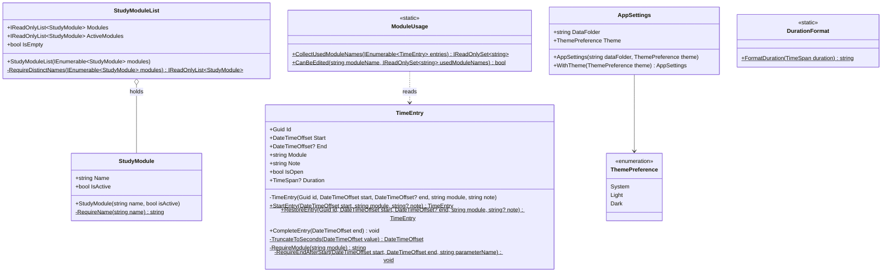

**`TimeEntry` is the core of the core.** Four things about it are noteworthy:

- **The open entry has no status field of its own.** An entry *is* open when `End` is missing. A
  second field next to it could contradict this; this one cannot.
- **From outside, only the end can be changed**, and only through `CompleteEntry`. The constructor
  is private; there are exactly two ways in, `StartEntry` for a new entry and `RestoreEntry` for
  one read from the file. A completed entry therefore cannot accidentally be ended a second time.
- **The duration is computed afresh on every access** and held nowhere. The rule from
  `DATENFORMAT.md` — start and end are authoritative, the duration is only a convenience for
  humans — is thereby not merely to be observed but impossible to bypass.
- **Points in time are truncated to the second** as soon as they come in. The system clock
  delivers seven decimal places, the file knows none. Truncation therefore happens here and not
  only on writing, so that the running display does not show a different duration from the one the
  file will later hold.

**`ModuleUsage` is the answer to a single question:** may this module still be renamed or deleted?
It may, as long as no time entry carries its name — because the name stands in plain text in
every entry. That is why `ModuleUsage` reads the entries, not the module list.

**`AppSettings` is immutable.** A changed appearance does not come about by assignment but as a new
instance via `WithTheme`.

## A3. The storage area

Eleven types. They translate between the model types and the three files and are the only place in
the program that touches the disk.

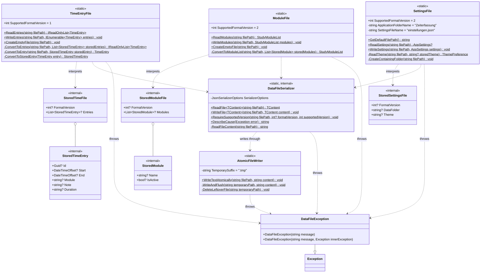

**The three file classes look alike because they have the same task.** Each reads, each writes,
each names its own `SupportedFormatVersion` — `zeiten.json` stands at 1, `module.json` and
`einstellungen.json` at 2. The number stands with the class that interprets the file, and nowhere
else.

**`DataFileSerializer` is the shared middle.** It knows the JSON settings that apply to all three
files. Two of them are intent and not convenience:

- **An unknown field makes the file fail** (`UnmappedMemberHandling.Disallow`). An extension of the
  format thereby necessarily costs a jump of the format version — it cannot happen silently.
- **The file is written indented** (`WriteIndented`). It is meant to stay readable and repairable
  by hand; that is a core concern of the project, not a cosmetic wish.

`RequireSupportedVersion` is the check that each of the three file classes calls immediately after
reading: **no value or a different number means rejection**, not an attempt at interpretation.

**`AtomicFileWriter` is the crash protection.** It writes into a side file with the extension
`.tmp`, pushes it all the way to disk with `Flush(flushToDisk: true)` and only then renames it.
Renaming is indivisible: either the new file is there in full, or the old one remains intact. If
writing fails, the side file is cleaned up — and if that fails too, it is left lying without
masking the actual error.

**`DataFileException` is the only exception this area lets out.** Everything that happens below —
missing file, broken JSON, locked file, an entry without an identifier — is wrapped in it, with a
message in full sentences. The shell catches exactly this one type and shows its message
unchanged.

## A4. The workflow and reporting areas

Eight types: two that run operation, and six that compute.

```mermaid
classDiagram
    direction TB

    class Workspace {
        -string TimeFileName = "zeiten.json"
        -string ModuleFileName = "module.json"
        +string DataFolder
        +string TimeFilePath
        +string ModuleFilePath
        -Workspace(string dataFolder)
        +OpenWorkspace(string settingsFilePath)$ Workspace?
        +CreateWorkspace(string settingsFilePath, string dataFolder, ThemePreference theme)$ Workspace
        +ReadModules() StudyModuleList
        +WriteModules(StudyModuleList modules) void
        +ReadEntries() IReadOnlyList~TimeEntry~
        +WriteEntries(IEnumerable~TimeEntry~ entries) void
        -RequireExistingFolder() void
        -RequireExistingFiles() void
        -CreateMissingFiles() void
    }

    class TimeTracker {
        -Workspace _workspace
        -TimeProvider _timeProvider
        -TimeEntry? _runningEntry
        +bool IsTracking
        +TimeEntry? RunningEntry
        +TimeTracker(Workspace workspace, TimeProvider timeProvider)
        +FindOpenEntry() TimeEntry?
        +StartTracking(string module, string? note) TimeEntry
        +StopTracking() TimeEntry
        +ResumeTracking(TimeEntry openEntry) void
        +CompleteOpenEntry(TimeEntry openEntry, DateTimeOffset end) TimeEntry
        +GetElapsedTime() TimeSpan
        -CompleteEntryInFile(Guid entryId, DateTimeOffset end) TimeEntry
    }

    class TimeReport {
        <<static>>
        +SummarizeByModule(IEnumerable~TimeEntry~ entries, DateRange range, StudyModuleList? knownModules, ModuleFilter? moduleFilter)$ IReadOnlyList~ModuleTotal~
        +SummarizeByWeek(IEnumerable~TimeEntry~ entries, DateRange range, ModuleFilter? moduleFilter)$ IReadOnlyList~PeriodTotal~
        +SummarizeByDay(IEnumerable~TimeEntry~ entries, DateRange range, ModuleFilter? moduleFilter)$ IReadOnlyList~PeriodTotal~
        +ComputeAverage(IReadOnlyList~PeriodTotal~ totals)$ TimeSpan
        +SelectRecentEntries(IEnumerable~TimeEntry~ entries, DateRange range, ModuleFilter? moduleFilter)$ IReadOnlyList~TimeEntry~
        +GetWeekStart(DateOnly day)$ DateOnly
        -SummarizePeriods(entries, range, moduleFilter, findPeriodStart, findNextPeriod)$ IReadOnlyList~PeriodTotal~
        -CreatePeriodTotal(DateOnly periodStart, IEnumerable~TimeEntry~ group)$ PeriodTotal
        -FillGaps(Dictionary~DateOnly, PeriodTotal~ totals, Func findNextPeriod)$ IReadOnlyList~PeriodTotal~
        -SelectCompletedEntries(IEnumerable~TimeEntry~ entries, DateRange range, ModuleFilter? moduleFilter)$ IEnumerable~TimeEntry~
        -CreateModuleTotal(IGrouping group, Dictionary~string, string~ knownSpellings)$ ModuleTotal
        -CollectKnownSpellings(StudyModuleList? knownModules)$ Dictionary~string, string~
        -SumDurations(IEnumerable~TimeEntry~ entries)$ TimeSpan
        -SumDurations(IEnumerable~TimeSpan~ durations)$ TimeSpan
    }

    class ModuleFilter {
        -HashSet~string~ _modules
        +ModuleFilter All$
        +bool IsActive
        +ModuleFilter(IEnumerable~string~ modules)
        +Matches(TimeEntry entry) bool
    }

    class DateRange {
        +DateRange Everything$
        +DateOnly? From
        +DateOnly? To
        +bool IsUnbounded
        -DateRange(DateOnly? from, DateOnly? to)
        +CreateRange(DateOnly? from, DateOnly? to)$ DateRange
        +ContainsEntry(TimeEntry entry) bool
    }

    class ModuleTotal {
        +string Module
        +TimeSpan Total
        +int EntryCount
        +bool IsKnownModule
        +ModuleTotal(string module, TimeSpan total, int entryCount, bool isKnownModule)
    }

    class PeriodTotal {
        +DateOnly PeriodStart
        +TimeSpan Total
        +int EntryCount
        +IReadOnlyDictionary~string, TimeSpan~ ModuleTimes
        +bool IsEmpty
        +PeriodTotal(DateOnly periodStart, TimeSpan total, int entryCount, IReadOnlyDictionary moduleTimes)
    }

    class CsvExport {
        <<static>>
        -string LineEnding
        -string DecimalHoursPattern = "0.####"
        -string[] Headers
        +BuildEntryCsv(IEnumerable~TimeEntry~ entries, DateRange range, CultureInfo culture, ModuleFilter? moduleFilter)$ string
        +CountExportedEntries(IEnumerable~TimeEntry~ entries, DateRange range, ModuleFilter? moduleFilter)$ int
        +CountSkippedEntries(IEnumerable~TimeEntry~ entries, DateRange range, ModuleFilter? moduleFilter)$ int
        -SelectExportableEntries(IEnumerable~TimeEntry~ entries, DateRange range, ModuleFilter? moduleFilter)$ IEnumerable~TimeEntry~
        -BuildFields(TimeEntry entry, CultureInfo culture)$ string[]
        -AppendRow(StringBuilder builder, IReadOnlyList~string~ fields, string separator)$ void
        -EscapeField(string field, string separator)$ string
    }

    TimeTracker --> Workspace : reads and writes through
    TimeTracker ..> TimeEntry
    Workspace ..> TimeEntryFile
    Workspace ..> ModuleFile
    Workspace ..> SettingsFile

    TimeReport ..> DateRange : filters with
    TimeReport ..> ModuleFilter : filters with
    TimeReport ..> ModuleTotal : returns
    TimeReport ..> PeriodTotal : returns
    CsvExport ..> DateRange : filters with
    CsvExport ..> ModuleFilter : filters with
    CsvExport ..> DurationFormat
    ModuleFilter ..> TimeEntry : checks
    DateRange ..> TimeEntry : checks
```

**`Workspace` is the chosen folder, as an object.** It knows the two file names and joins them with
the folder path; outside this class, `zeiten.json` and `module.json` do not occur anywhere in the
program. The two entry points differ in one respect:

- **`OpenWorkspace`** reads the settings. If there are none, it returns `null` — that is the sign
  of the first start on this computer and not an error. If there are some, the folder *and* both
  files must be present, otherwise a `DataFileException` follows with the hint that OneDrive may
  not be finished yet.
- **`CreateWorkspace`** requires an existing folder, creates missing files empty and only then
  writes the settings. The order is intentional: a remembered path under which nothing lies would
  be worse than none at all.

**`TimeTracker` runs the session.** It holds the running entry in memory, but it does not rely on
it: `StartTracking` and completing read the file afresh every time, change the list and write it
back in full. That is the answer to the file travelling via OneDrive — whatever arrived from the
other computer in the meantime is not lost this way.

`FindOpenEntry` is at the same time a check: **more than one entry without an end is an error**,
not a state the app tries to interpret. It says so and asks for manual work on the file.

The clock comes from outside, as a `TimeProvider`. In operation that is `TimeProvider.System`, in
the tests a staged clock — which is why durations can be checked without waiting.

**`TimeReport` computes without displaying anything.** Four reports, all following the same
pattern: filter the period, leave out open entries, group, sum up. Three subtleties:

- **Open entries count nowhere.** They have no duration. The report window points out separately
  that a session is running.
- **Gaps are filled** (`FillGaps`). A week without entries between two weeks with entries appears
  with zero hours instead of being missing — otherwise the chart would show a false course.
- **Modules are grouped regardless of upper and lower case**, but shown under the spelling from
  `module.json` as long as the module is still listed there. If it no longer is, the spelling of
  the most recent entry wins, and `IsKnownModule` is false — the window then remarks "steht nicht
  mehr in module.json" ("no longer in module.json").

**`DateRange` compares only the start day.** A session across midnight thus belongs entirely to the
day on which it began. `Everything` is the unbounded period.

**`ModuleFilter` is the selection of modules a report is restricted to**. An empty
selection does not mean "no module" but "no restriction" — `All` lets every entry through. The
comparison ignores upper and lower case. The week, day and entry reports as well as the CSV export
take the filter as their last, optional parameter.

**`PeriodTotal` carries the breakdown along.** `ModuleTimes` holds the time of the week or day per
module; a module without time is missing from the dictionary and counts as zero. Together the
values add up to `Total`. That way `SummarizePeriods` computes once, and table and chart read the
same figures. **`ComputeAverage`** forms the mean over all periods of the sequence — the empty ones
in between count as zero.

**`CsvExport` follows Windows.** Separator and decimal mark come from the regional settings, not
from the code — on a German computer, therefore, semicolon and comma, just as Excel expects there.
The duration stands in the file twice: once as a decimal for computing, once as
hours:minutes:seconds for reading.

## A5. The shell

Twelve types: four windows, two helpers, four row types, an enumeration and the application itself.
It is wired up by code-behind — the `Handle…` methods are the event handlers registered
in the XAML.

```mermaid
classDiagram
    direction TB

    class App {
        -SingleInstanceGuard? _instanceGuard
        #OnStartup(StartupEventArgs eventArguments) void
        #OnExit(ExitEventArgs eventArguments) void
        -ReadStoredTheme()$ ThemePreference
        -HandleUnhandledException(object sender, DispatcherUnhandledExceptionEventArgs e) void
    }

    class SingleInstanceGuard {
        <<internal>>
        -string MutexName = "Local\\Zeiterfassung.SingleInstance"
        -Mutex _mutex
        +bool IsOwner
        +SingleInstanceGuard()
        +ActivateRunningInstance()$ void
        +Dispose() void
        -FindWindowOfRunningInstance()$ IntPtr
        -ReleaseOwnership() void
        -SetForegroundWindow(IntPtr windowHandle)$ bool
        -ShowWindow(IntPtr windowHandle, int command)$ bool
    }

    class AppearanceSetup {
        <<static, internal>>
        -string PersonalizeKeyPath
        -List~Window~ WatchedWindows
        -HashSet~Window~ ActivelyWatched
        -ThemePreference _preference
        +ThemePreference CurrentPreference
        +ApplyTheme(ThemePreference preference)$ void
        +RegisterWindow(Window window)$ void
        -HandleWindowClosed(object? sender, EventArgs e)$ void
        -UpdateWatching(Window window)$ void
        -ResolveTheme(ThemePreference preference)$ ApplicationTheme
        -ReadSystemTheme()$ ApplicationTheme
    }

    class MainWindow {
        -DispatcherTimer _elapsedTimer
        -string _settingsFilePath
        -Workspace? _workspace
        -TimeTracker? _tracker
        -ReportWindow? _reportWindow
        -bool _isCompactMode
        -double _fullWidth
        -double _fullHeight
        +MainWindow()
        -HandleContentRendered(object? sender, EventArgs e) void
        -OpenOrChooseWorkspace() void
        -ChooseDataFolder() void
        -PrepareTracking() void
        -ResolveOpenEntry() void
        -HandlePlayClick(object sender, RoutedEventArgs e) void
        -HandleStopClick(object sender, RoutedEventArgs e) void
        -StopTracking() bool
        -HandleChooseFolderClick(object sender, RoutedEventArgs e) void
        -HandleModuleSelectionChanged(object sender, SelectionChangedEventArgs e) void
        -HandleTimerTick(object? sender, EventArgs e) void
        -HandleWindowClosing(object? sender, CancelEventArgs e) void
        -HandleReportClick(object sender, RoutedEventArgs e) void
        -HandleReportWindowClosed(object? sender, EventArgs e) void
        -HandleCompactClick(object sender, RoutedEventArgs e) void
        -HandleExpandClick(object sender, RoutedEventArgs e) void
        -HandleManageModulesClick(object sender, RoutedEventArgs e) void
        -HandleThemeClick(object sender, RoutedEventArgs e) void
        -HandleThemeChoice(object sender, RoutedEventArgs e) void
        -SaveThemeChoice(ThemePreference chosen) void
        -UpdateThemeMenu() void
        -ReloadModules(string? previousSelection) void
        -SelectModule(string moduleName) void
        -ShowElapsedTime() void
        -ShowStatus(string message) void
        -ShowProblem(string headline, string message, bool offerFolderChoice) void
        -ApplyStatusColors(string backgroundKey, string borderKey, string accentKey) void
        -EnterCompactMode() void
        -LeaveCompactMode() void
        -SetFullViewVisibility(Visibility visibility) void
        -UpdateWindowTitle() void
        -ShortenForTitleBar(string moduleName)$ string
        -UpdateControlState() void
        -UpdateToolTips(bool isTracking) void
    }

    class OpenEntryDialog {
        -string EndInputPattern = "dd.MM.yyyy HH:mm:ss"
        -TimeEntry _openEntry
        +OpenEntryChoice Choice
        +DateTimeOffset ChosenEnd
        +OpenEntryDialog(TimeEntry openEntry)
        -HandleCompleteClick(object sender, RoutedEventArgs e) void
        -HandleResumeClick(object sender, RoutedEventArgs e) void
        -HandleEndInputChanged(object sender, TextChangedEventArgs e) void
        -TryReadEnd(DateTimeOffset end) bool
        -ShowHint(string hint) void
    }

    class OpenEntryChoice {
        <<enumeration>>
        Undecided
        Complete
        Resume
    }

    class ModuleDialog {
        -Workspace _workspace
        -IReadOnlySet~string~ _usedModuleNames
        -List~StudyModule~ _modules
        -bool _isListReadable
        +bool WasChanged
        +ModuleDialog(Workspace workspace)
        -LoadModules() void
        -ShowModules(string? nameToSelect) void
        -HandleSelectionChanged(object sender, SelectionChangedEventArgs e) void
        -HandleNameChanged(object sender, TextChangedEventArgs e) void
        -HandleAddClick(object sender, RoutedEventArgs e) void
        -HandleRenameClick(object sender, RoutedEventArgs e) void
        -HandleDeleteClick(object sender, RoutedEventArgs e) void
        -HandleToggleClick(object sender, RoutedEventArgs e) void
        -SaveModules() bool
        -FindExistingModule(string name) StudyModule?
        -UpdateButtonState() void
        -UpdateToolTips(ModuleEditRow? row, bool hasName, string name) void
        -ShowMessage(string message, SymbolRegular symbol, string colorResourceKey) void
    }

    class ReportWindow {
        -Workspace _workspace
        -SKColor[] ModulePalette$
        -HashSet~string~ _selectedModules
        -Dictionary _moduleColumns
        -List~string~ _filterOptions
        -bool _isUpdatingDates
        -bool _isUpdatingFilter
        +ReportWindow(Workspace workspace)
        -LoadReport() void
        -RefreshFilterOptions(List~string~ names) void
        -RebuildFilterList() void
        -BuildRange() DateRange?
        -ReadModulesIfPossible() StudyModuleList?
        -HandleModuleFilterClick(object sender, RoutedEventArgs e) void
        -HandleAllModulesClick(object sender, RoutedEventArgs e) void
        -HandleModuleCheckChanged(object sender, RoutedEventArgs e) void
        -HandleBreakdownChanged(object sender, RoutedEventArgs e) void
        -HandleChartWheel(object sender, MouseWheelEventArgs e) void
        -HandleThemeChanged(ApplicationTheme currentTheme, Color accentColor) void
        -HandleWindowClosed(object? sender, EventArgs e) void
        -HandleDateChanged(object sender, SelectionChangedEventArgs e) void
        -HandleEverythingClick(object sender, RoutedEventArgs e) void
        -HandleRefreshClick(object sender, RoutedEventArgs e) void
        -HandleExportClick(object sender, RoutedEventArgs e) void
        -AskForTargetPath() string?
        -WriteCsvFile(string targetPath, IReadOnlyList~TimeEntry~ entries, DateRange range, ModuleFilter moduleFilter) void
        -BuildExportNote(string targetPath, IReadOnlyList~TimeEntry~ entries, DateRange range, ModuleFilter moduleFilter)$ string
        -ShowModules(IReadOnlyList~ModuleTotal~ totals) void
        -ShowWeeks(IReadOnlyList~PeriodTotal~ totals, IReadOnlyList~string~ modules) void
        -ShowDays(IReadOnlyList~PeriodTotal~ totals, IReadOnlyList~string~ modules) void
        -ChooseBreakdownModules(IReadOnlyList~string~ modules) IReadOnlyList~string~
        -CreatePeriodRow(string label, PeriodTotal total, IReadOnlyList~string~ modules)$ PeriodRow
        -ConfigureModuleColumns(DataGrid grid, IReadOnlyList~string~ modules) void
        -ShowPeriodChart(CartesianChart chart, IReadOnlyList~PeriodTotal~ totals, IReadOnlyList~string~ modules, Func formatLabel, double labelsRotation) void
        -PickModuleColor(string module) SKColor
        -ShowEntries(IReadOnlyList~TimeEntry~ entries, DateRange range, ModuleFilter filter) void
        -ShowSummary(IReadOnlyList~ModuleTotal~ totals, DateRange range) void
        -ShowOpenEntry(IReadOnlyList~TimeEntry~ entries) void
        -CreateHourAxis() Axis
        -CreateLabelAxis(IReadOnlyList~string~ labels, double labelsRotation) Axis
        -ApplyChartTheme(CartesianChart chart) void
        -ReadThemeColor(string resourceKey, SKColor fallback) SKColor
        -CreateEntryRow(TimeEntry entry)$ EntryRow
        -FormatHours(double hours)$ string
        -FormatWeek(DateOnly weekStart)$ string
        -FormatShortWeek(DateOnly weekStart)$ string
        -FormatDay(DateOnly day)$ string
        -FormatShortDay(DateOnly day)$ string
        -FormatRange(DateRange range)$ string
        -ToDateOnly(DateTime? value)$ DateOnly?
        -ShowProblem(string message) void
        -ShowNote(string message) void
        -ShowMessage(string message, string colorResourceKey) void
        -HideMessage() void
    }

    class ModuleRow {
        +string Module
        +string Total
        +int EntryCount
        +string Hint
        +ModuleRow(string module, string total, int entryCount, string hint)
    }

    class PeriodRow {
        +string Period
        +string Total
        +int EntryCount
        +string[] ModuleTimes
        +PeriodRow(string period, string total, int entryCount, string[] moduleTimes)
    }

    class EntryRow {
        +string Day
        +string Period
        +string Module
        +string Note
        +string Duration
        +EntryRow(string day, string period, string module, string note, string duration)
    }

    class ModuleEditRow {
        +string Name
        +bool IsActive
        +bool IsUsed
        +string State
        +string Usage
        +ModuleEditRow(string name, bool isActive, bool isUsed)
    }

    App --|> Application
    MainWindow --|> FluentWindow
    ReportWindow --|> FluentWindow
    OpenEntryDialog --|> FluentWindow
    ModuleDialog --|> FluentWindow
    SingleInstanceGuard ..|> IDisposable

    App --> SingleInstanceGuard : holds
    App --> MainWindow : opens
    App ..> AppearanceSetup

    MainWindow --> ReportWindow : holds while open
    MainWindow ..> OpenEntryDialog : modal
    MainWindow ..> ModuleDialog : modal
    MainWindow ..> AppearanceSetup
    OpenEntryDialog --> OpenEntryChoice : answers with
    ModuleDialog ..> ModuleEditRow : fills
    ReportWindow ..> ModuleRow : fills
    ReportWindow ..> PeriodRow : fills
    ReportWindow ..> EntryRow : fills
    ReportWindow ..> AppearanceSetup
    ModuleDialog ..> AppearanceSetup
```

**All four windows inherit from `FluentWindow`**, not from `Window` — that comes with WPF-UI
 and is the reason the windows draw their own title bar and switching between light and
dark is possible at all.

**`App` does three things at start-up, in this order**: fend off a second instance, apply the
stored appearance, open the main window. The order matters — the window is not meant to flash
light first and then turn dark. If reading the settings fails, the appearance silently falls back
to *System*; an error message before the first window would be out of place here, and the same
file is read and reported properly a moment later.

**`SingleInstanceGuard` is a named lock object of the operating system** (a mutex with the prefix
`Local\`, i.e. per Windows session). Whoever does not get it is the second start: it looks for the
window of the first, brings it to the front and quits without a word. The advantage of a mutex
over a lock file is that it does not outlive a crash.

**`AppearanceSetup` binds the appearance to Windows — or deliberately does not.** If the choice is
*System*, every window is registered with WPF-UI for watching and changes along with a switch
while running. With *Light* or *Dark* the watching is explicitly deregistered — otherwise Windows
would overwrite the choice at the next switch. The class therefore keeps two lists: the known
windows and those of them currently being watched.

**`MainWindow` is the largest piece of the shell**, because it holds everything together: folder
choice, module list, Play and Stop, the running clock, the two dialogs, the report window, compact
mode and the menu for the appearance. It decides nothing in domain terms — each of these paths ends
in a call into the core. Two patterns recur:

- **`UpdateControlState` and `UpdateToolTips` are the only place where buttons are disabled and
  enabled.** After every change of state the whole set is determined afresh, instead of switching
  individual buttons on the spot. Every disabled button says in its tooltip why.
- **`ShowStatus` and `ShowProblem` are the only place where anything is reported.** A message
  brings back the full view — in compact mode it could not be seen.

**`ReportWindow` is not modal**: recording goes on while one looks at it. It reads
afresh from the file at every `LoadReport` and computes nothing itself; all totals come from
`TimeReport`. The lion's share of its methods is formatting and building charts. **The module
filter** (`_selectedModules`) affects weeks, days, entries, the summary line and the CSV export,
not the *Module* (modules) tab; the list of check boxes (`RefreshFilterOptions`) is only rebuilt
when the set of modules changes, so that it does not shift under the mouse. **The switch *Je Modul
/ Nur Summe*** ("per module / total only") decides whether `ShowWeeks` and `ShowDays` give modules
their own columns in chart and table. If only one module has a column of its own,
`ShowPeriodChart` leaves out the total column, because it would be just as tall; the table keeps
its columns. One peculiarity: **the charts have to be redrawn when the appearance changes**,
because LiveCharts2 draws with colours passed in explicitly and not with those of the theme —
otherwise the axis labels would be black on a black background.

**`ModuleDialog` locks itself when it cannot read the list.** If `_isListReadable` is false, every
button is disabled — writing would irretrievably overwrite the modules that stand in the unreadable
file. What is possible with a module is decided not by this dialog but by `zeiten.json`:
`ModuleUsage` says whether time has already been booked on it.

---

# Part B — The flows

Six flows, one per diagram. The kind depends on what matters in the respective flow:
**flowcharts** where the branches are the point, **sequence diagrams** where the interplay between
shell, core and file needs explaining.

| No. | Flow | Kind | Why this kind |
|---|---|---|---|
| B1 | Program start | flowchart | Seven paths lead from the start to a usable window |
| B2 | The open entry | flowchart | One decision by the user with three outcomes |
| B3 | From Play to Stop | sequence diagram | What goes to disk along the way is the heart of the matter |
| B4 | Reporting and output | sequence diagram | Interplay of two windows with the same file |
| B5 | Maintaining modules | flowchart | What is allowed depends on the state |
| B6 | Choosing the appearance | flowchart | The *System* branch behaves differently from the fixed ones |

## B1. Program start

From the double-click to the usable window. The flow has seven exits, only one of which is the
normal case.

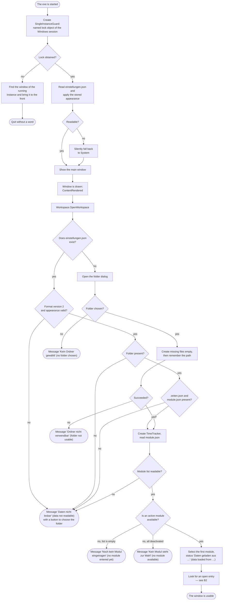

**The check for the second instance comes first**, even before any window. Two instances would
work on two independent states of the same `zeiten.json`, and the second would overwrite the work
of the first. The lock object carries the prefix `Local\`, so it applies per Windows session, and
it does not outlive a crash.

**The appearance is applied before the window**, so that it does not flash light first and then
turn dark. If reading fails here, nothing is reported — the same file is read again by
`OpenWorkspace` seconds later, and that is where the message belongs.

**The folder dialog is not an error case but the first start.** `OpenWorkspace` returns `null` if
the settings file does not exist; only when it is there and does not fit is it rejected.

**The order when creating is intentional:** first the files, then the remembered path. A path
under which nothing lies would be worse than none at all.

**Four of the seven exits are messages** — and they differ in one point that is easy to overlook:
with "Daten nicht lesbar", "Kein Ordner gewählt" and "Ordner nicht verwendbar" there is a button
for choosing the folder underneath, because that is where the remedy lies. With the two messages
about the module list it is missing: the data folder is fine, the way forward leads through module
maintenance (B5).

## B2. The open entry

An entry without an end time means: last time, Stop was not pressed — the app crashed, or the user
switched to the other computer without Stop. The app does not decide this itself but presents both
ways.

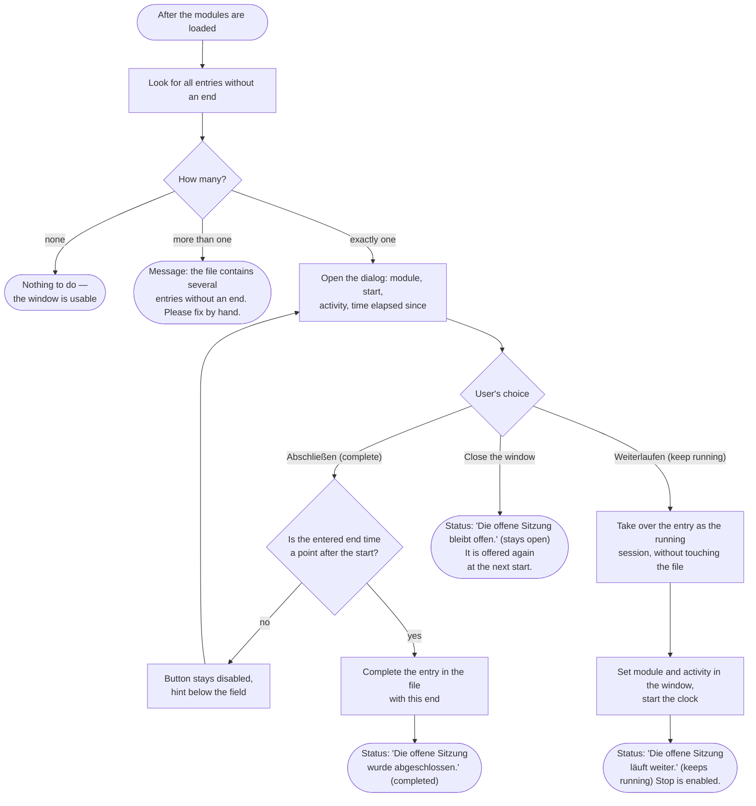

**More than one open entry is an error, not a state.** The app could guess which one is meant — it
does not, but asks for manual work on the file. That this is reasonable is the premise under which
`zeiten.json` is kept readable and repairable.

**The two ways differ in whether anything is written.** *Complete* changes the file at once: the
entry gets its end, the file is rewritten in full. *Keep running* does not touch the file at all —
the open entry stays open, the app merely takes it over as the running session. Writing then only
happens at Stop.

**Dismissing the dialog is a valid third way.** Whoever does not want to decide gets the question
again at the next start. Nothing is lost.

**The end time is checked while typing**, not only on the click: as long as the input is not a
point in time after the start, the button stays disabled and says why in its tooltip.

## B3. From Play to Stop

The path the app is really about — and the one where the most goes to disk. The three columns on
the right are the core, the two on the left are the shell.

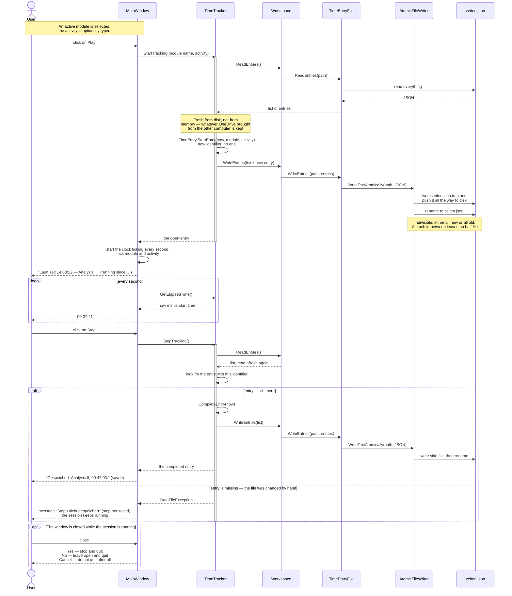

**Play writes at once.** That is the first of the two crash protections: a session that has begun
is on disk before anything can go wrong. If the app crashes afterwards, the entry is open — and the
app can deal with open entries at the next start (B2).

**Before every write, the file is read afresh.** The `TimeTracker` keeps the running entry in
memory, but it does not rely on it when writing. Because the file travels via OneDrive and because
it is rewritten in full at every change, whatever arrived from the other computer in the meantime
would otherwise be lost.

**Writing itself is the second crash protection.** Side file, push to disk, rename — renaming is
the only indivisible step, and that is why it comes last.

**The error case at Stop is real and not theoretical.** If `zeiten.json` is edited by hand while
the app is running, the entry with the remembered identifier may have vanished. The app reports
this and lets the session keep running instead of silently losing it.

**The running clock computes, it does not count.** Every tick asks for the difference between now
and the start time. A missed tick — for instance while the computer sleeps — therefore does not
falsify the display.

## B4. Reporting and output

The report window is **not modal**: recording goes on while one looks at it. It reads,
it does not compute itself, and it never writes into the data files.

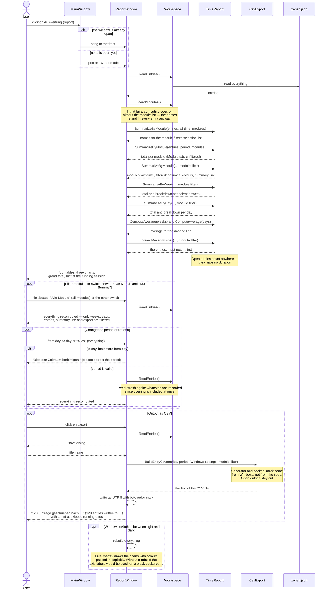

**There is always at most one report window.** A second click brings the existing one to the
front. That is not cosmetic: two windows reading the same file would be harmless — but the main
window holds on to only one of them and would not know, after closing, which one is still open.

**Reading happens afresh at every opportunity**, on opening as well as on every change of the
period. A session that has just been stopped in the main window thus shows up in the totals at once
after a click on refresh.

**The module list can be dispensed with, the entries cannot.** If `module.json` cannot be read, the
window computes anyway — the module names stand in plain text in every entry, after all. It just
can no longer say which module is still in the list and which is not.

**The export only leads outward.** Reading a changed CSV file back in is not intended and will not
be.

## B5. Maintaining modules

Reachable via the bookshelf symbol in the title bar, disabled while a session is running. What is
possible with a module is decided not by the dialog but by `zeiten.json`.

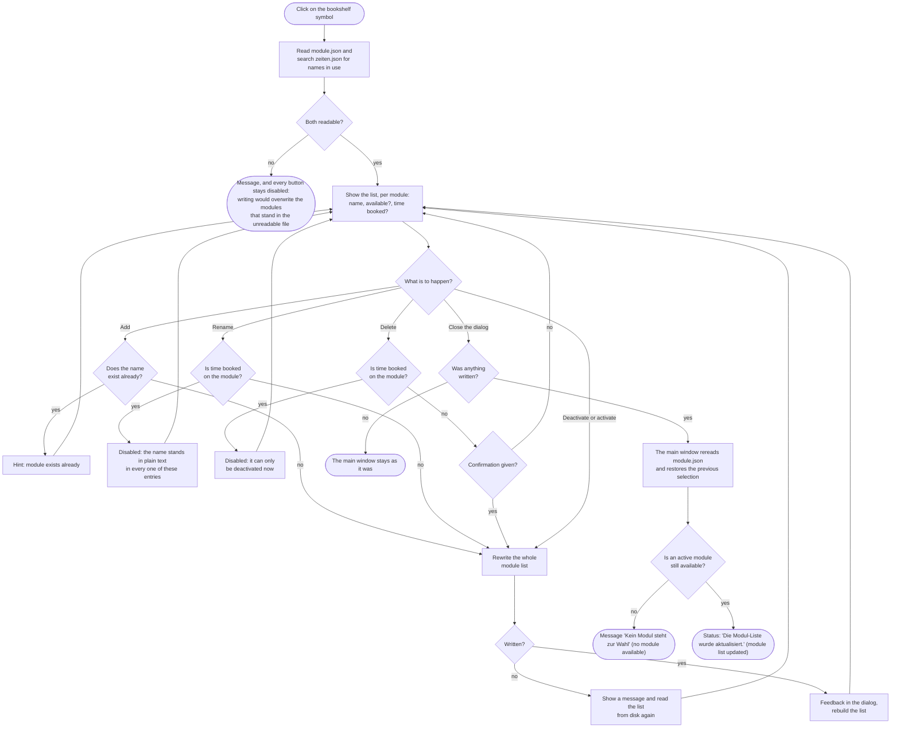

**The boundary runs between used and unused.** A module without any time entry can be renamed and
deleted freely. As soon as an entry runs on it, its name stands in plain text in the time file —
then only *deactivate* remains: it disappears from the selection and keeps counting in the report.
Every disabled button says in its tooltip which of the two reasons applies.

**Writing happens after every single change**, not only on closing. The dialog therefore has no
"cancel": what it shows is already in the file.

**If writing fails, the dialog reads anew.** Otherwise it would show a state that does not exist on
disk — and the next change would make it permanent.

**The file remains editable by hand alongside.** Both ways exist side by side; the dialog has no
privilege over `module.json`. But because the file **travels**, both computers must be on format
version 2 before a module is maintained in the app.

## B6. Choosing the appearance

Three choices in the title bar menu: *Wie das System* (like the system), *Immer hell* (always
light), *Immer dunkel* (always dark). The choice takes effect at once, survives a restart and
applies per computer.

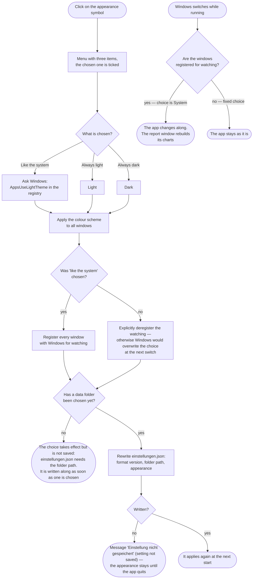

**The choice *System* is not a third colour value but a subscription.** With *Light* and *Dark*
the colour is fixed; with *System* the colour scheme of Windows is adopted **and** every window is
registered for later switches. That is exactly why switching to a fixed choice has to deregister
explicitly — otherwise the registration would remain and overwrite the choice at the next switch
by Windows.

**Registration happens per window, not per app.** `AppearanceSetup` therefore keeps two lists: all
known windows and those of them currently being watched. Every new window registers on opening and
is removed from both lists on closing.

**Before the first folder, nothing is saved.** `einstellungen.json` holds the folder path and the
appearance together; without a folder there would be nowhere for the file to go. The choice still
takes effect at once and is written along when the folder is set up — that is why the folder choice
passes the current setting on to `CreateWorkspace`.

**Colours are never hard-coded.** They are always set as a resource reference, in XAML with
`DynamicResource`, in code with `SetResourceReference`. A hard-coded colour would not survive the
switch. The only exception are the charts: LiveCharts2 draws with colours passed in explicitly,
which the report window reads afresh from the theme at every switch.
